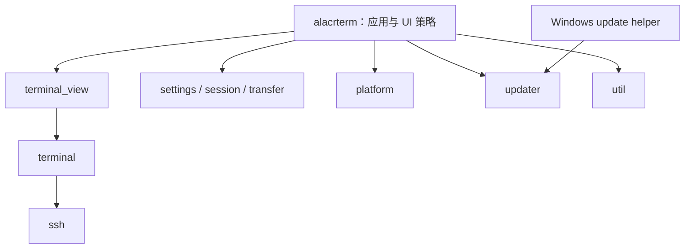

# Alacrterm 架构

Alacrterm 是基于 Rust、GPUI 和 gpui-kit 的桌面终端，支持本地 Shell、SSH、SFTP 文件管理、X11 转发和在线升级。终端模拟使用 `alacritty_terminal`。本文描述当前代码的职责与运行方式；构建入口见 [CI 与打包](../scripts/packaging/README.md)。

## 模块与依赖

工作区包含 11 个 crate。应用层负责组装能力与交互策略，下层不依赖应用入口。

| Crate | 职责与主要入口 |
| --- | --- |
| `alacrterm` | `main.rs` 启动与 `AppRoot`；窗口、Dock 布局、侧边栏、对话框、配置适配、补全提供器、升级 UI |
| `terminal_view` | `TerminalView` 的输入、焦点、IME、补全交互；`TerminalElement` 的网格布局与绘制 |
| `terminal` | `Terminal` 实体、模拟器状态、本地 PTY/SSH 后端适配、协议事件、目录和命令状态 |
| `ssh` | russh 连接、认证、主机密钥、远端 PTY、辅助命令连接、SFTP 和 X11 信道 |
| `settings` | 无 UI 的配置模型、校验、路径选择、偏好持久化、按键与配色解析 |
| `session` | 保存的会话与文件夹、稳定 ID、树编辑、序列化和连接请求数据 |
| `transfer` | 传输任务标识、进度、取消与完成状态；实际网络传输由 `ssh` 执行 |
| `platform` | Windows ConPTY 初始化；WayX 进程、就绪检测、退出及显示端点管理 |
| `updater` | 更新元数据校验、下载、安装准备、平台安装接口及 Sparkle 桥接 |
| `alacrterm-update-helper` | Windows 独立更新进程，在主程序退出后验证并启动安装程序 |
| `util` | 原子写入、缓存、资源监视、日志基础设施、路径与 Shell 等通用工具 |



图中展示主要职责链，完整依赖以各 crate 的 `Cargo.toml` 为准。`terminal` 本身使用 GPUI 实体，不是完全脱离 UI 执行环境的模拟器库；`ssh` 不依赖 GPUI，跨执行器通过命令和事件通道通信。

## 启动与应用生命周期

`crates/alacrterm/src/main.rs` 初始化日志，Windows 在创建首个 PTY 前初始化 ConPTY，然后启动 GPUI 应用。应用注册嵌入资源、主题、按键、配置与共享模型，创建主窗口和 `AppRoot`。

`AppRoot` 持有工作区布局与跨组件状态，协调当前终端上下文、会话列表、文件管理器、传输面板、设置窗口和更新入口。组件通过实体句柄、事件和观察订阅协作；后台结果返回应用执行器后才修改 UI。

`exit_coordinator.rs` 统一处理主窗口关闭、升级重启及 macOS 原生退出，不弹确认、不因连接、传输或未保存预览阻止退出。立即释放终端、丢弃未保存预览，并取消普通传输和预览写回；等待传输工作线程清理未完成目标文件后结束进程。最终退出时停止 WayX，并释放日志写入守卫以刷新缓冲。Linux 仅打开系统安装工具的操作不退出应用，也不关闭会话。

## 布局、标签与焦点

- `main.rs` 组装标题栏、左右面板、中央终端区及全局底部状态栏。`status_bar.rs` 承载面板切换和当前会话相关操作。
- gpui-kit 的 `DockArea` / `TabGroup` 管理终端标签组与停靠分屏；`tab_bar.rs` 提供应用自己的标签栏外观、拖动、工具栏与焦点策略。
- `terminal_panel.rs` 的 `TabPane` 管理标签内容和终端视图；`pane_layout.rs` 另有标签内部的二叉分屏树。Dock 标签组与标签内部格子是两个层级，不能用同一个索引或焦点状态代替。
- 标签栏工具只在当前活动组显示。点击 `+` 打开 gpui-kit 菜单，可选择本地终端或保存的会话；菜单展开时保留该组的工具栏，避免菜单抢走焦点后入口消失。选择完成时才设置新终端的目标组。
- 保存的会话菜单包含折叠文件夹中的记录，仅快照名称和 ID；点击后按稳定 ID 解析最新会话数据。
- Zoom 放大一个终端标签组，隐藏外围工作区并将标签栏放到标题栏位置。保留组内标签左右重排，禁止通过拖动创建其他 Dock 组。它不改变终端进程，也不等同于操作系统全屏。
- 标题栏拖动、标签拖动、终端内容框选有独立的命中和事件处理；只有从终端内部开始的拖动才触发终端框选。

## 终端运行与渲染

### 数据流

```text
键盘 / IME / 粘贴 → TerminalView → Terminal → 本地 PTY 或 SSH
本地 PTY / SSH 输出 → VT 解析与协议事件 → Terminal 状态与快照
Terminal 通知 → TerminalView 重绘 → TerminalElement 布局、绘制
```

`TerminalTarget` 区分本地与 SSH。`TerminalBackend` 统一写入、调整尺寸和关闭接口：本地由 Alacritty PTY 事件循环驱动；远端由 russh 连接提供字节流，不启动本地 `ssh` 子进程。`LaunchOptions` 注入 Shell 准备、SSH 会话准备、X11 目标和自定义 OSC 解码器，具体脚本由应用层持有。

`ssh` 使用独立线程中的 Tokio 运行时。远端输出按块发送并受待消费字节额度约束，最后一个消费者释放数据后归还额度；断开关闭等待，避免输出积压阻塞退出。终端侧批量消费已就绪事件并合并通知，远端 VT 解析目前仍在 UI 执行路径上。协议响应、标题、剪贴板等解析器事件需要及时处理，不能只刷新网格。

终端状态与进程/连接生命周期归 `terminal` 和后端所有。视图持有订阅、输入状态和光标任务；重连替换网络任务并清理旧的定时状态。不得在 `session` 的保存记录中复制一套实时连接状态。

### 输入与绘制

GPUI 先派发匹配上下文的 Action，再进入终端按键处理。`Terminal` 键上下文用于区分复制、滚动等应用操作和应编码后发送给 Shell 的输入；默认绑定来自 `assets/keymaps/default-*.json`。

`TerminalElement` 使用终端快照绘制背景、文本、块字符、选择区、链接与光标，并提供 IME 定位。交互产生的内部事件在同步阶段处理，因此 `TerminalView` 同时观察终端通知，保证拖选和滚动及时重绘。

输出或相关状态变化更新快照，纯光标闪烁复用已有内容；可见行缓存复用未变化的布局。网格按设备像素对齐，备用屏幕或最新内容占满底行时采用底部锚定，将不足一行的余量放到顶部，减少调整窗口大小时的抖动。同步更新协议有超时结束机制，防止远端未关闭更新区间导致画面长期停住。

### 补全

`terminal_view` 管理补全会话、选择、弹窗及输入替换，应用层 `completion/` 实现 `CompletionService`，提供命令、历史、参数、路径与项目候选。即时候选与后台查询分开，后台结果通过代次/上下文检查防止覆盖更新输入。远端目录查询通过 SFTP，避免向交互式命令行插入查询命令。初始补全与已输入命令完全匹配时，Enter 可直接交给终端执行。

## Shell 集成与 SSH

应用层 `shell_integration/` 使用 `include_str!` 将 `scripts/shell_integration/` 脚本编译进程序，安装包不需要额外的脚本目录。

本地 Bash、Zsh、PowerShell 会话将脚本写入会话专属临时目录，通过 `--rcfile`、`ZDOTDIR` 或 `-File` 加载，保留原有启动配置。临时资源由 PTY 生命周期持有，结束后释放；自定义 Shell 参数会跳过本地注入。

远端集成先尝试设置会话激活环境变量，再通过辅助 SSH 连接执行安装脚本。Bash/Zsh 脚本持久化到远端 `~/.local/share/alacrterm/shell/`，对应启动配置增加加载入口；版本与 Shell 类型清单用于判断是否更新。入口只在带激活标记的交互式会话加载，不把安装命令输入交互终端。环境变量被服务器拒绝或安装失败时继续普通登录。`ALACRTERM_SHELL_INTEGRATION=0` 禁用注入，远端还受设置开关控制。

脚本通过 OSC 上报命令阶段、工作目录、Shell 类型和可用命令，`protocol.rs` 解码应用扩展，终端核心统一维护集成脚本上报的 cwd、OSC 7 与标题目录线索，文件管理器读取同一目录状态跟随远端 `cd`；精确上报不被标题中的缩写路径覆盖。未启用集成时仍可利用远端已有的 OSC 输出和目录线索，但信息完整程度取决于 Shell。

SSH 认证支持 agent、密钥与配置的密码。默认主机密钥策略对未知主机请求用户确认并保存到 `known_hosts`，已知主机密钥变化时拒绝连接。`SshFs` 按需建立 SFTP 连接，独立于交互终端的数据流。

## 文件管理、预览与传输

`sidebar_panel/sessions.rs` 负责会话树的 UI 选择和展开状态，`session` 负责数据编辑与保存。稳定 ID 用于跨对话框、移动和重命名定位记录，树路径用于当次结构操作。

`sidebar_panel/files.rs` 负责当前文件系统、目录、选择及加载状态，本地使用文件系统接口，远端使用 `SshFs`。工具栏与路径输入框固定，文件列表单独滚动；文件夹单击选择、双击跳转。路径输入支持候选，跳转失败时保留输入、清空列表并提示错误。

`preview_window.rs` 与 `preview_cache.rs` 管理文件预览、编辑和临时资源。远端预览通过缓存下载，保存后回传；退出应用时直接丢弃未保存内容。`transfer_manager.rs` 将 SSH 传输事件适配到 `transfer` 状态模型与 UI。取消请求不立即删除任务，等待工作线程删除正在写入的未完成目标文件后再完成收尾；已完成文件及源文件保留。`SshFs` 统一追踪排队和运行中的传输，包括预览写回。连接和目录扫描可取消，文件复制取消也可中断网络等待。远端清理依赖 SFTP 连接和权限；无法删除时记录警告，不能保证离线远端已清理。

## 配置、资源与日志

### 用户配置

发布构建的配置只从系统用户目录读写，不回退到安装或源码目录：

| 平台 | 配置目录 |
| --- | --- |
| Windows | `%APPDATA%\Alacrterm`，即 Roaming |
| macOS | `~/Library/Application Support/Alacrterm` |
| Linux | `$XDG_CONFIG_HOME/alacrterm`，默认 `~/.config/alacrterm` |

主要文件为 `app.json`、`terminal.json`、`sessions.json`、可选 `keymap.json` 和独立的 `update.json`。Debug 构建使用仓库根目录下被 Git 忽略的 `config/`，不与发布配置互相回退。首次保存创建目录，不自动迁移旧配置。

`SettingsStore` 按字段合并，保留未知字段；损坏 JSON 不直接覆盖。配置与会话使用同目录临时文件和原子替换，保存错误返回调用方；终端数值配置集中校验。安装包不携带用户配置。

### 资源

SVG 图标和默认按键通过 `rust-embed` 提供；Shell 脚本通过 `include_str!` 嵌入。`assets/app-icon.svg` 为图标单一真源，派生的 `app-icon.ico` 用于 Windows 可执行文件及安装器；预生成的 `assets/app-icon-128.png`、`app-icon-256.png` 和 `app-icon.icns` 分别用于 Linux 与 macOS，打包直接复制。修改 SVG 后安装 `scripts/packaging/requirements-icons.txt` 中的手动生成依赖，运行 `python scripts/packaging/generate_icons.py` 更新并提交派生文件；Windows 安装目录无需另放 ICO。

全局主题和终端配色位于 `themes/global`、`themes/terminal`。外部资源覆盖内置默认；`util::resource_registry` 管理资源与目录监听，应用的 `resource_registry.rs` 提供 GPUI 适配。无效修改保留最后有效资源，删除恢复默认；后台解析与去抖后回到 UI 应用结果，旧代次通知被丢弃。偏好和资源是两类数据，资源热更新不反向保存用户偏好。

### 日志

保留现有 `log::*` 调用，`tracing-log` 桥接到 tracing subscriber，`tracing-appender` 异步写文件。直接 `eprintln!` 仍只输出 stderr，不被桥接捕获。

| 平台 | 日志目录 |
| --- | --- |
| Windows | `%LOCALAPPDATA%\Alacrterm\logs` |
| macOS | `~/Library/Logs/Alacrterm` |
| Linux | `$XDG_STATE_HOME/alacrterm/logs`，默认 `~/.local/state/alacrterm/logs` |

按 UTC 日期滚动，保留当天及之前六天，无文件大小或总容量上限；启动和每小时清理匹配的日志文件。文件统一命名为 `<程序>-YYYY-MM-DD.log`，不区分 debug/release、PID 或启动标识；同一程序当天的多个启动追加到同一文件。默认应用 INFO、依赖 WARN，`RUST_LOG` 可覆盖；现有 DEBUG 日志可能包含终端输入与远端命令。写入队列满时可能丢事件，目录不可用则回退 stderr；正常退出刷新，强制终止不保证尾部日志落盘。

WayX 子进程的 stdout、stderr 通过独立后台管道读取，分别写入 `wayx-YYYY-MM-DD.log`、`wayx-err-YYYY-MM-DD.log`；UTC 每日滚动，保留当天及之前六天，启动及每小时清理，无容量上限。Windows 目录为 `%LOCALAPPDATA%\Alacrterm\wayx`，macOS 为 `~/Library/Logs/Alacrterm/wayx`，Linux 为 `$XDG_STATE_HOME/alacrterm/wayx`（默认 `~/.local/state/alacrterm/wayx`）。同一天追加到同一程序文件，保留原始字节，不受 `RUST_LOG` 过滤；停止或启动失败不删除日志。无法创建某个日志时，该流继承父进程的对应输出；退出时先结束子进程，再限时等待管道排空。此前固定文件不自动迁移或删除。

## 平台插件与 X11

源码按平台分类，安装包只携带目标平台插件，并去掉平台目录层级：

```text
源码：plugins/windows/wayx-windows-x64/ → 安装：plugins/wayx-windows-x64/
源码：plugins/windows/conpty/           → 安装：plugins/conpty/
源码：plugins/linux/wayx-linux-x64/     → 安装：plugins/wayx-linux-x64/
源码：plugins/macos/wayx-macos-arm64/    → 安装：plugins/wayx-macos-arm64/
```

这些路径相对于主可执行文件目录；macOS 位于应用包的 `Contents/MacOS` 下。运行时兼容安装布局与源码布局。WayX 可通过 `WAYX_RUNTIME_DIR` 指定运行目录。

Windows 的 `conpty.dll` 与 `OpenConsole.exe` 配套放在 `plugins/conpty`，初始化时设置 DLL 查找路径；也兼容旧版主程序同级文件。找不到可用捆绑后端时退回系统 ConPTY。Inno Setup 升级会删除旧的根目录 ConPTY 文件和 `plugins/windows`。

`platform::Wayx` 管理 X Server 进程、就绪、显示号与启动代次，防止取消启动后旧任务重新恢复运行。`alacrterm::x11` 将显示端点适配给 SSH，`ssh::x11` 负责转发请求、cookie 验证及信道转发。WayX 相关许可保留在 [wayx-LICENSE](wayx-LICENSE)。

## 在线升级

`alacrterm::updates` 为设置页和普通标题栏提供共享模型。`Phase` 将签名版本、下载进度或包路径直接放入对应状态；安装前校验与准备在后台执行。标题栏发现更新后显示入口，点击弹出当前版本/可用版本对话框，提供取消和立刻更新；Zoom 不显示该入口。

Windows/Linux 发布构建在启用自动检查时启动后约 30 秒检查，之后每六小时检查；下载由用户触发。Debug 不在线检查。取消会中断网络等待或哈希校验，未完成下载可用于恢复。缺少可信公钥时不执行在线升级，提供手动下载入口。

| 平台 | 更新链路 |
| --- | --- |
| Windows | minisign 签名 JSON → 校验版本、大小和 SHA-256 → 下载 Inno 安装器 → 独立 helper 准备并确认 → 应用清理后退出 → helper 等待应用/WayX 结束 → 静默安装并重启 |
| macOS | Sparkle 2.10.1 标准 UI 与安装器，Rust/Objective-C 桥接；EdDSA 校验更新 ZIP，应用使用 ad-hoc 临时签名，不做 Developer ID 签名或公证 |
| Linux deb | 验证签名元数据及 deb，打开可用的系统安装工具；否则显示安全引用路径的 `sudo apt install` 命令，由系统处理提权与依赖，安装后手动重启 |

Windows 每次安装使用唯一任务目录、按安装位置隔离的跨进程锁，以及 ready/commit 握手。主程序只在 helper 准备就绪且退出清理完成后提交安装；取消更新操作时清理未提交 helper。helper 再次独立验证，结果写入任务目录，应用下次启动读取。安装失败不承诺自动回滚。

macOS 使用 Sparkle 原生流程，不使用 `sparklers`。推迟重启回调与原生退出路径接入退出协调器；跳过、取消、关闭和更新周期结束会清理临时状态。应用不会自行覆盖 macOS 应用包或 Linux 系统目录。

### 发布配置与流水线

`.github/workflows/` 仅编排命令和调用脚本；打包、签名与发布实现位于 `scripts/packaging/`，Python 回归测试位于 `scripts/test/`。

- `test`：分支 push、PR，以及复用调用；先 fmt，再执行 Clippy、Python 与 C 状态回归；Linux、Windows、macOS 并行运行应用、库及 SSH 本地服务器测试。macOS 准备 Sparkle，覆盖原生桥接的构建路径。
- `package`：分支 push、PR，以及复用调用；生成 Linux x64 deb、Windows x64 Inno 安装器、macOS ARM64 DMG/更新 ZIP，产物保留七天。每个平台附带构建清单，记录完整提交 SHA、版本、运行 ID/attempt、构建公钥指纹及每个文件的大小与 SHA-256。
- `release`：tag 触发；校验 tag、版本与签名配置，选择同一完整 SHA 的本仓库分支 push Test、Package 成功运行；不使用 PR 合并构建。复用确定运行 ID 的三平台产物，完整校验后在独立 macOS job 签名 ZIP，再生成更新源、上传草稿并发布。只有产物过期时重新调用三平台 Package，不为正常发布重复编译。

CI 最长等待一小时；对应分支运行缺失五分钟后明确失败，失败/取消立即阻止发布。新产物缺平台、身份或摘要不符、公钥变化都报错，不能混用不同运行。失败重跑的不同 attempt 可共同提供同一 run ID 的完整平台集合。分支 push 保留检查记录，PR 则取消旧运行；检查/测试/打包超时分别为 30/45/60 分钟，签名与发布为 30 分钟。Rust 缓存按用途区分，Sparkle 缓存按下载脚本身份区分，读取时仍校验固定摘要。

发布阶段串行执行，按语义版本决定是否设为 latest；不假定 GitHub concurrency 是 FIFO 队列，取消的待发布运行可重跑。生成签名更新源后，一次调用 `gh release create --draft` 上传全部附件，再直接公开；不查找或恢复旧草稿，不重新下载远端附件校验，也不生成发布清单。同 tag 的 Release 已存在时创建失败，不覆盖既有附件；上传失败留下的草稿需要先手动清理再重试。安装包来源、摘要与签名的发布前校验保留，发布前后仍核对 tag 指向。

GitHub Repository Variables：`ALACRTERM_UPDATE_PUBLIC_KEYS` 为一个或多个 minisign 公钥 Base64 行，`SPARKLE_PUBLIC_KEY` 为 Sparkle 公钥。两者分别服务 JSON 更新源和 Sparkle 更新包，不是同一套密钥。

GitHub Repository Secrets：

| 名称 | 内容 |
| --- | --- |
| `MINISIGN_SECRET_KEY` / `MINISIGN_PASSWORD` | 完整 minisign 私钥文件及密码；无密码密钥可留空密码 |
| `SPARKLE_PRIVATE_KEY` | Sparkle 导出的私钥 Base64 文本 |

私钥不入仓库。所有 macOS 包均使用 ad-hoc 临时签名，不要求付费 Apple 开发者账号，也不做 Developer ID 签名或公证；正式发布仍要求 Sparkle 更新包签名。首次打开可能被 Gatekeeper 拦截，尝试打开后可在“系统设置 → 隐私与安全性”中允许打开。Windows 安装器目前未做 Authenticode 签名。轮换更新密钥需先发布同时信任新密钥的版本，再切换后续签名。

更新入口固定为 GitHub Releases latest 下的 `update.json` / `appcast.xml`；包 URL 指向具体版本。保留 macOS bundle ID `com.alacrterm.app` 与 Windows `AppId=Alacrterm`，避免破坏后续升级。

## 验证与维护边界

常用本地检查与 CI 保持一致：

```sh
cargo fmt --check
cargo clippy --locked --all-targets --all-features -- -D warnings
cargo test --locked -p alacrterm -p terminal_view -p updater -p alacrterm-update-helper -p util -p settings -p session -p transfer -p platform
cargo test --locked -p ssh --lib --test roundtrip
python -m unittest discover -s scripts/test -p 'test_*.py'
bash scripts/test/test_sparkle_state.sh
```

修改能力模块时补充对应 crate 的定向验证，例如 `settings`、`session`、`ssh`、`transfer` 或 `platform`。需要宿主显示与实际 WayX 的测试可能默认忽略，不能把跳过视为已验证。上述命令也不代表整个 workspace 的所有测试已覆盖。

Linux 检查不能替代 Windows ConPTY/Inno 或 macOS AppKit/Sparkle 原生验证。布局、焦点、拖动和菜单需要 GUI 回归；在线升级需要真实签名与前后两个版本的安装演练，覆盖取消、损坏包、多实例、路径含空格、未保存文件及用户配置保留。
