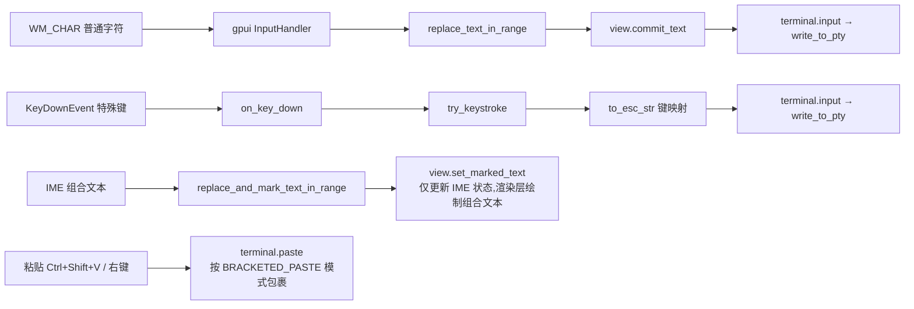

# alacrterm 终端实现分析

> 最新事件、背压及缓存契约见 [终端运行时重构](terminal-runtime.md)。

> 分析对象:`crates/` 全部源码（含 `crates/ssh`，内建 SSH 客户端）。本文只写**结论与契约**:模块职责、数据结构、必须遵守的约束(⚠️ = 易错 / 必须这样写)。
> §3 = 应用外壳(多会话 / 侧边栏 / 标签栏 / 弹窗 / 状态栏),§4 起 = 终端核心(仿真 / 渲染 / 事件循环),§5 起含远端会话(SSH)。

---

## 1. 项目概述

`alacrterm` = **`gpui-pre 0.3`**(依赖名仍为 `gpui`)做 UI + **`gpui-kit 0.6`**(包名 `gpui-component`,自绘组件库)做组件 + **`alacritty_terminal 0.26`** 做仿真。终端核心由 Zed 的 `terminal` / `terminal_view` 精简而来,应用外壳(多会话 + 远程连接)自建。

**核心特征:**

- 终端核心:去掉 Zed `settings` 依赖 / 主题系统 / 搜索 UI,保留事件循环、4ms 批量事件、选择复制、vi mode、超链接、鼠标协议、进程标题检测
- 渲染由 gpui 的 `StyledText` / `paint_quad` 逐 cell 驱动,与 Alacritty 网格通过 `Content` 快照解耦(§4.2)
- `TerminalBuilder::new(working_directory, target, env, cx) -> Task<Result<TerminalBuilder>>`:`target` 决定本地 PTY 还是远端 russh(见 §5.2);就绪后经 `subscribe(cx)` 接上事件
- 多会话外壳:**最左一条整列** = 48px 图标栏(VS Code 式活动栏:每枚图标 = 一个视图,底部「设置」;点图标切换 / 折叠侧边栏)+ 侧边栏面板(默认折叠),再往右是中间 dock 会话区(自绘标签栏 + 终端),会话可全部关掉(全关显示欢迎页,**启动时也是这个状态**——不自动开终端);**状态栏每列各一条但都是空条**(gpui-kit 同一个 `StatusBar`、同一个 28px 高,见 §3.6):侧边栏面板下沿一条(折叠时不摆)、中间列终端区下方一条(**没有终端就不摆**);两侧都在时它们同高同底,看上去就是窗底一条连续的条——最左那 48px 图标栏仍**一路铺到窗口底部**(照 VS Code)。**文件管理器**的组织照 MobaXterm:面板标题栏下面一条**工具栏**(上一目录 / 下载 / 上传 / 刷新 / 新建文件夹 / 新建文件 / 删除 / 重命名 / 编辑),再往下才是路径框与目录树
- 远程连接:走**内建 SSH 客户端**(`crates/ssh`,基于 russh),不调用外部 `ssh` 命令。「新建会话」对话框收集 IP / 端口 / 名称 / 用户名 / 密码,**只往侧边栏的会话列表里加一条记录**(IP / 名称 / 用户名必填);双击那条记录才按它开终端(密码参与认证但只存在内存记录里);首次连接未知主机弹**「未知主机密钥」**对话框让用户核对指纹
- 独立设置窗口 + 自绘标题栏;Action 风格右键菜单
- 会话显示名:用户填的名称优先,否则回退终端 OSC 标题;进程结束只标记「已断开」(标签与内容保留)、不退出应用

**依赖栈:**

| 依赖 | 用途 |
|---|---|
| `gpui`(`gpui-pre 0.3`) | UI 框架、窗口、文本布局、事件分发 |
| `gpui-kit`(`features = ["component"]`) | 标题栏 / Sidebar / Tabs / StatusBar / Settings / Resizable、`icon_named!`、主题系统 |
| `alacritty_terminal 0.26` | VT 解析、网格模型、PTY 封装(`tty`) |
| `russh 0.63` + `russh-sftp 3`(`crates/ssh`) | 内建 SSH 客户端(终端通道 + SFTP:浏览远端目录 / 上传 / 下载 / 写回);⚠️ **必须关掉默认的 `aws-lc-rs`** 改用 `ring`,否则 Windows 上要 NASM |
| `tree-sitter` + 几种 grammar(经 gpui-kit 的 `tree-sitter-*` feature) | 预览窗口里那个编辑器的**语法高亮**(bash / python / json / yaml / toml / rust / js / ts / tsx / c / cpp / markdown,见 §3.5.1);⚠️ **故意不**开 `tree-sitter-languages`(全开要拖进三十多个 grammar crate) |
| `dirs 7` | 预览缓存目录 / 系统下载目录 |
| `portable-pty 0.9` | 经 alacritty `tty` 间接使用的跨平台 PTY |
| `sysinfo 0.39` | 前台进程 / 工作目录 / 标题检测(仅 `crates/terminal`,应用层已不再依赖) |
| `rust-embed` | 内嵌 `assets/icons` |
| `windows 0.62` | `SearchPathW`、`GetProcessId` |
| `futures` / `parking_lot` | 事件循环 `select_biased!` 批处理、`FairMutex` Term 锁 |
| `schemars` / `serde` | `TerminalColors` 等配置的 Schema;自定义 Action 的 `Deserialize` |

---

## 2. 整体架构

```mermaid
graph TB
    subgraph app层[crates/alacrterm]
        MAIN[main.rs<br/>AppRoot:共享状态/布局装配]
        SBAR[status_bar.rs<br/>每列底部状态栏(都是空条)]
        SIDE[sidebar_panel/<br/>最左整列:图标栏 + 侧边栏]
        COMP[components/<br/>活动栏 / 侧边栏(自绘)]
        TPANEL[terminal_panel.rs<br/>标签页生命周期 + TabPane 分屏]
        TABBAR[tab_bar.rs<br/>自绘标签栏]
        DIALOG[dialog/<br/>新建会话 / 新建文件夹 / 输入名字 / 主机密钥]
        SETWIN[settings_window.rs]
        ACT[actions.rs]
    end

    subgraph view层[crates/terminal_view]
        VIEW[lib.rs<br/>TerminalView]
        ELEM[terminal_element.rs<br/>渲染管线]
        CONTRAST[contrast.rs<br/>APCA 对比度]
    end

    subgraph core层[crates/terminal]
        TERM[terminal.rs<br/>Terminal 实体 + 事件循环]
        ALAC[alacritty.rs]
        PTYINFO[pty_info.rs]
        BACKEND[backend.rs<br/>TerminalTarget + TerminalBackend]
        HYPER[alacritty/hyperlinks.rs]
        MAP[mappings/]
    end

    subgraph ssh层[ssh]
        SESS[session.rs<br/>OS 线程 + russh 会话]
        FSM[sftp fs.rs]
        AUTH[auth.rs / handler.rs / params.rs]
    end

    subgraph util层[crates/util]
        SHELL[shell.rs]
        PATH[paths.rs / rel_path.rs]
    end

    MAIN --> VIEW
    MAIN --> SIDE
    SIDE -->|组件| COMP
    MAIN --> TPANEL
    MAIN --> TABBAR
    MAIN --> SBAR
    MAIN --> DIALOG
    MAIN --> SETWIN
    MAIN -->|注册全局监听器| ACT
    MAIN -->|组件| GPUIC[gpui-kit]
    TPANEL --> TABBAR
    VIEW --> TERM
    TERM --> ALAC
    TERM --> MAP
    TERM --> SHELL
    term --> SSHBE
    SSHBE --> SESS
    SESS --> AUTH
    SESS --> FSM
    TERM -->|远端 SFTP 句柄| FSM
    ALAC --> PTYINFO
    ALAC --> HYPER
    HYPER --> PATH
    ALAC -.-> OS["OS 伪终端 / conpty<br/>tty::Pty"]
    SESS -.-> NET["远端 sshd<br/>(TCP)"]
```

### 目录结构

```
Cargo.toml                      # workspace 根(resolver = "3", edition 2024)
assets/
  icons/                        # rust-embed 内嵌(含 SquareTerminal 等)
  keymaps/                      # 内嵌的默认按键绑定 default-{windows,macos,linux}.json(§3.12)
crates/
  alacrterm/                    # 应用层(§3)
    src/
      main.rs                   # 入口 + AppRoot(根视图:跨组件共享状态 + 布局装配)
      terminal_panel.rs         # 标签页生命周期 + SessionRequest + TabPane(dock 面板)
      tab_bar.rs                # 自绘标签栏
      status_bar.rs             # 每列底部的空状态栏;STATUS_BAR_HEIGHT
      sidebar_panel/            # 最左整列:图标栏 + 侧边栏(§3.2)
        mod.rs                  # Sidebar 实体(当前视图/折叠/宽度 + Render) + SidebarView + SidebarContent
        activity_bar.rs         # 把整列装配到本应用:每个视图一枚图标 + 底部「设置」 + 当前视图的面板 + 文件管理器顶部工具栏(§3.2)
        header.rs               # 面板标题栏(当前视图的标题 + 「…」菜单)
        shared.rs               # 两棵树共用:行骨架 / 缩进 / 省略号标签 / RowCache / 拖拽预览卡片
        sessions.rs             # SessionsState(记录模型 + 文件夹树 + 增删改 + 摊平成 SessionsItem)
        files.rs                # FilesState(文件管理器:远端 SFTP 目录树 + 传输行 + 摊平成 FilesItem)
      components/               # 应用自有的可复用组件(base + 自绘)
        mod.rs                  # 组件模块出口
        activitybar.rs           # VS Code 式**整列**(ActivityBar / ActivityBarItem:48px 图标列 + sidebar 成员)
        sidebar.rs              # 侧边栏面板外壳(Sidebar / SidebarRow:标题栏槽 + 懒渲染的行列表 + 滚动条)
      dialog/                   # 对话框(§3.4)
        mod.rs                  # 共同约定(表单实体先建 / 页脚自拼 / on_ok 兜底校验)
        connection.rs           # 「新建会话」:只加一条 SSH 记录
        folder.rs               # 「新建文件夹」:会话列表分组
        name.rs                 # 「输入名字」:文件管理器的新建文件夹 / 新建文件 / 重命名共用
        host_key.rs             # 「未知主机密钥」:首次连接让用户核对指纹
      welcome.rs                # 无会话时中间列的欢迎页
      settings_window.rs        # 独立设置窗口
      preview_window.rs         # 独立文件预览窗口(一个窗口多个标签;自绘标题栏 + 工具条 + 标签 + 状态栏;文本可改并写回远端;见 §3.5.1)
      format.rs                 # 显示用的小格式化(字节数 / 时长)
      actions.rs                # 自定义 Action + 全局监听器
      assets.rs                 # 图标资产
  terminal_view/                # 视图层
    src/
      lib.rs                    # TerminalView:创建(本地 / SSH)/订阅/输入/焦点/IME/滚动
      terminal_element.rs       # TerminalElement:三阶段渲染管线(约 1800 行)
      contrast.rs               # APCA 最小对比度
  terminal/                     # 核心层:仿真 + PTY + 事件循环
    src/
      terminal.rs               # Terminal 实体、事件系统、输入/鼠标/滚动(约 2600 行)
      alacritty.rs              # alacritty_terminal 桥接层 + PtySender(往本地 PTY 写输入)
      backend.rs                # 后端抽象:TerminalTarget(连什么) + TerminalBackend(谁搬字节)
      pty_info.rs               # sysinfo 进程查询
      alacritty/hyperlinks.rs   # OSC 8 / URL 正则 / 路径猜测
      pty_info.rs               # sysinfo 进程查询(Pty / None 两种 PID 来源)
      mappings/                 # keys.rs mouse.rs colors.rs
  util/                         # shell 探测、路径工具
crates/ssh/                      # 内建 SSH 客户端(russh)
  src/
    lib.rs                      # 模块文档:边界、运行时、认证顺序、主机密钥
    session.rs                  # 专属 OS 线程 + tokio 运行时;命令/事件两条通道
    auth.rs                     # agent → 私钥文件 → 密码
    handler.rs                  # 主机密钥校验(Ask / AcceptNew / Strict)+ 确认请求
    params.rs                   # SshParams / SshAuth / HostKeyPolicy / SshSize
    fs.rs                       # SshFs:SFTP 子系统(浏览 + 传输各一条连接,都是懒连接)
    error.rs                    # SshError(连不上哪个地址 / 认证 / 主机密钥变更 / 传输已取消…)
  examples/local_server.rs      # 本机验证用的假服务端(玩具 shell + 可读写的 sftp 子系统)
```

---

## 3. 应用外壳:启动、布局与会话

### 3.1 应用入口(`main.rs`)

```rust
fn main() {
    gpui_kit::application()
        .with_assets(assets::Assets)
        .with_quit_mode(QuitMode::LastWindowClosed)   // 全部窗口关闭即退出
        .run(|cx: &mut App| {
            gpui_kit::init(cx);                       // 必须先于任何组件渲染
            config::install(cx);                      // 配置三步(顺序固定):
            config::load_themes(cx);                  //   ① 解析 config/*.json ② 登记主题库
            config::apply_saved_themes(cx);           //   ③ 按 app.json 挂主题槽位
            config::change_theme(ThemeMode::Dark, cx); // 投影主题 + 重新压主题覆盖(list.active_highlight)

            let bounds = Bounds::centered(None, size(px(1100.), px(700.)), cx);
            cx.open_window(
                WindowOptions {
                    window_bounds: Some(WindowBounds::Windowed(bounds)),
                    ..TitleBar::window_options()      // 隐藏系统标题栏,改自绘
                },
                |window, cx| {
                    let root = cx.new(|cx| AppRoot::new(window, cx));  // 启动不建会话(首屏欢迎页)
                    AppRoot::register_actions(root.downgrade(), cx);   // 全局 action 监听器
                    cx.new(|cx| Root::new(root, window, cx))           // 外层包 gpui-kit Root
                },
            )
            .expect("failed to open window");
        });
}
```

- 窗口 1100×700;`Assets` 来自 `assets.rs` 的 `icon_named!(IconName, "../../assets/icons")`(扫描图标目录生成枚举,并实现 `From<IconName> for AnyElement` / `RenderOnce`)
- **启动形态**:不建任何会话,侧边栏默认折叠(`Sidebar::new` 里 `visible: false`)⇒ 首屏 = 标题栏 + 48px 图标栏 + 中间列的欢迎页(**两条状态栏都不在**——它们各自只在有内容时摆,见 §3.6),终端由用户自己开(欢迎页「新建终端」/ 标签栏 `+` / 双击会话记录)
- `Root` 是弹窗 / 通知 / 焦点恢复的宿主:Dialog / Sheet / 通知 / Tooltip / 原生菜单都由**插件**自己渲染(`crates/base/src/root.rs` 的 `RootPlugin`,`gpui_kit::init` 里注册)⇒ 渲染树里**不需要**再挂 `Root::render_dialog_layer`(该 API 已随 gpui-kit 新版移除)
- `TitleBar::window_options()` 内部为 `appears_transparent` + `app_owns_titlebar_drag`
- 标题栏内容区(`TitleBar::new().child(..)`,见 §3.5):只有 `flex_1` 的标题「Alacrterm」(窗口控制按钮由 `TitleBar` 自己给)——整列的显示 / 折叠与「设置」入口都在最左的**图标栏**(见 §3.2),标题栏里不放按钮。⚠️ 内容区整体是窗口拖拽区(`WindowControlArea::Drag`),以后要往这里放按钮,都得包 `div().occlude()`,否则点击被当成「拖标题栏」而收不到

### 3.2 布局装配(标题栏 / 最左整列 / 分栏 / dock 会话面板 / 两列各自的状态栏)

`AppRoot::render` 只负责装配:`h_resizable("main-split")[最左整列, 中间列]` —— 第 0 个面板就是**最左整列**(48px 图标栏 + 侧边栏面板,面板宽 = 二者之和,`SIDEBAR_PANEL_INDEX`);**折叠时整列只剩那 48px 图标栏**,没有可拖的缝,这时不摆分栏组,直接 `h_flex[图标栏, 中间列]`(图标栏因此**始终在**);容器渲染方法统一返回 `AnyElement`(edition 2024 下 `impl Trait` 会捕获 `&mut Context` 生命周期,同一渲染树里连续 `&mut cx` 会借用冲突)。

**状态与渲染都归子组件**:最左整列 = 一个实体(`Entity<Sidebar>`,全应用一个,见 `sidebar_panel/mod.rs`),它自带当前视图 / 折叠 / 期望宽度 / 那一组 `ResizableState`,并**自己实现 `Render`**(整列 = 48px 图标栏 + 侧边栏面板;图标栏**一路铺到窗口底部**,面板下沿是侧边栏自己的状态栏,见 §3.6);根视图只把它 `.child(..)` 摆进第 0 个分栏面板。两个视图是两个实体:「会话」`Entity<SessionsState>` 与文件管理器 `Entity<FilesState>` —— 两者都**不实现 `Render`**:各自把「要摆哪些行」摊成**一行一项**(`SessionsItem` / `FilesItem`)交给侧边栏面板的行列表(它才按可见区间懒渲染);同一时刻只摆其中一个(另一个仍活着、状态不丢)。`AppRoot` 只剩跨组件的共享状态(标签表 `tabs` / `active` / `dock` / 设置窗口句柄 / 背景焦点)。⚠️ `Entity::read(cx)` 会把 `cx` 借到返回值活着的整段时间,所以「既要读状态又要 `cx.listener`」的地方先把它拷成小值(`Pixels` / `Entity` 句柄 / `.downgrade()`)。⚠️ 整棵树还没上 `.cached()`,每帧重建(见 `docs/gpui-architecture.md` §10)。

- **最左整列**(`sidebar_panel` + `components`):**图标栏在左(48px)、侧边栏面板在右** —— 侧边栏是活动栏的一个成员(`ActivityBar::sidebar`),两块都由 `components/` 里自有的组件画(见下一条)。整列的装配在 `sidebar_panel/activity_bar.rs` 的 `left_column`:每个可用视图一枚 `ActivityBarItem`(图标 24px,由「名义尺寸 32px × 0.75」得出)、底部一枚「设置」(贴底,派发全局 `OpenSettings`),折叠时**一枚都不亮**且不挂侧边栏面板。点某一枚 = 让侧边栏显示这个视图,再点**正在显示**的那枚 = 折叠侧边栏(`Sidebar::toggle_view`),照 VS Code 折叠不另设开关。视图只有 `Sessions`(会话)与 `Files`(文件管理器)两种,同一时刻只摆一个;⚠️ **「文件管理器」只对远端(SSH)会话摆出来**:根视图每帧按**键盘焦点所在**的那一格终端是不是远端调 `Sidebar::set_files_enabled`(见 §3.3「当前标签页」那条),为假时该视图的**图标与内容一起不摆**(当前选中的视图不动,会话换回远端时它自己回来);本地目录用系统自己的文件管理器打开就好,应用里再摆一份既多余、又只能看到本机目录。
- **活动栏**(`components/activitybar.rs` 的 `ActivityBar` / `ActivityBarItem`):一列 48px 见方的图标按钮,顶部一组、底部一组贴着列沿,列底色取 `title_bar`(与标题栏同色),**右缘一条 `sidebar_border` 竖线**(与侧边栏面板 / 中间列的分界)。⚠️ 结构用 gpui-kit **base** 的 `h_flex` / `v_flex` / `div` + gpui `Styled` 搭,只有两件 base 没有的小东西复用 `component`:图标用 `Icon`(尺寸要显式给,`svg()` 不吃父元素颜色)、悬停提示用按钮自带的 `.tooltip()`(base 的 tooltip 只给弹层内容、触发器要自己接线)。每枚活动项:图标**一律同色**(不按选中 / 未选中压暗或提亮),当前项只靠一条 2px 左端指示条(`primary`)区分;悬停 / 按下有底色(`secondary_hover` / `secondary_active`)。
- **侧边栏面板**(`components/sidebar.rs` 的 `Sidebar` / `SidebarRow`):自绘的侧边栏外壳 —— 顶部固定标题栏 + **工具栏槽**(`Sidebar::toolbar`,标题栏与列表之间那条,只有「文件管理器」挂) + 下方可滚动的行列表 + 底部状态栏槽(`Sidebar::status_bar`)。三个槽都固定高、不随内容滚动。外观照 `component::sidebar`(底色 `tokens.sidebar`、`sidebar_border` 画在右侧、标题栏 `pt_3` + `px_3`、内容 `px_3` + `gap_y_3`、列表首尾各留呼吸空间),实现**优先用 base**:`v_flex` / `div` + gpui 的 `list`(`ListState`,按可见区间要行)+ base 的 `Scrollbar`(`ListState` 自己就实现了 base 的 `ScrollbarHandle`),不依赖 `component::Sidebar`。⚠️ 行会被列表反复取用 ⇒ 行类型要实现 `SidebarRow`(`Clone` + `render(&mut App)`);本应用的行类型是 `SidebarContent`(`SessionsItem` / `FilesItem` 两个枚举)。⚠️ 标题行必须显式 `.h(PANEL_HEADER_HEIGHT)`(28px),否则空 flex 容器会塌成 0。
- **面板标题栏**(`Sidebar::render_header`,见 `sidebar_panel/header.rs`):挂在侧边栏面板的 `header` 槽(固定、不随内容滚动),摆当前视图的标题 + 右端「…」菜单(`Button` + `DropdownMenu`,菜单 = 每个可用视图一项、勾选当前那个,点一下就切过去)。

#### 会话列表(文件夹树:记录 + 拖放)

> 状态在 `sidebar_panel/sessions.rs` 的 `SessionsState` 实体里(记录模型 + 展开状态 + 摊平后的行清单);渲染交给 `SidebarContent::Sessions(SessionsItem)` —— **一行一项**摆进侧边栏内容位。

列表内容是**会话记录**(连接配置),与终端实例**完全无关**:一条记录有没有在跑终端,取决于用户是否双击过它;关掉终端也不影响列表。形态参考 MobaXterm —— **没有自动生成的根文件夹**,顶层直接就是用户自己建的文件夹(可嵌套)与记录;文件夹行只显示名字(**不显示「里面有几条」**)。

- **数据**:`SessionsState::entries: Vec<SessionEntry>`(私有,读写都经 `SessionsState` 的方法),`enum SessionEntry { Folder(SessionFolder), Session(SessionRecord) }`;路径用 `SessionPath = Vec<usize>`(从顶层开始的下标链,`[]` = 顶层本身)。
- **加条目**:在「会话」视图的**空白处 / 面板标题上右键** → 顶层「新建会话」(`NewSession{folder: None}`,落顶层)、「新建文件夹」(`NewFolder{parent: None}`,落顶层) —— 原来是那一栏状态栏两端的两枚按钮;文件夹行右键可以「在这里新建会话 / 新建子文件夹」(带 `folder` / `parent` 参数落进那个文件夹)。新条目一律**追加到目标目录末尾**,并顺手展开目标文件夹(否则新条目看不见)。
- **删条目**:记录行右键「删除会话」、文件夹行右键「删除文件夹」(**连带**里面的内容)。两条都只改列表,不动已开的终端。
- **开终端**:双击记录行(单击只选中)、或右键「打开会话」→ `OpenSession` → `AppRoot::open_session_record`(**跨组件:**向 `SessionsState` 要参数、再 `spawn_session`)。同一条记录可以开任意多个终端。
- **拖放**:记录行与文件夹行都能拖(载荷 `DragSessionEntry{path,label}` + 共用预览卡片 `shared::DragPreview`);落在**文件夹行**上 = 放进该文件夹,落在**会话行**上 = 放进它所在的那个目录,落在列表下方那条 16px 空白落点(`#session-tree-top-level-drop`)上 = **提到顶层**;`drag_over` 用 `tokens.accent` 高亮落点。合法性由 `SessionsState::move_entry` 把关:目标必须存在、且不能是**自己或自己的子孙**(否则会把子树拖成环)。⚠️ 取出源条目会让同目录里排在它后面的下标前移一位,所以目标路径要按「取出后」算(`shift_path_after_removal`)。
- **行**(`session_row_element`,返回 `AnyElement` 因为它把右键菜单包在外面):**同一目录下文件夹与会话同级**——两行都从 `pl(8px + depth × 16px)` 开始(不给会话行多加一个 caret 宽度的缩进,否则会话看上去低一级)。文件夹行 = 有子项时才画的 caret + 文件夹图标 + 名字;会话行 = 地球图标 + 名字(记录目前只有 SSH 一种)。caret 只看「有没有子项」(`SessionRow::has_children`):空文件夹没有 caret、点了也只选中。
- **展开状态存在 `SessionsState::expanded`**(`Vec<u64>`,存的是条目 **id**),由行点击经 `SessionsState::activate_row` 改;改完 `RowCache::bump` 让摊平缓存失效。⚠️ 用**稳定 id** 而不是下标链:增删 / 拖动搬家都不会让展开状态串到邻居身上(早先按路径存时,删除后同目录里排在后面的标记都得跟着挪。那套 `shift_paths_after_removal` 已经删掉)。
- ⚠️ **虚拟化靠外层侧边栏的列表**:与「文件管理器」同一套(机制见下节 §3.2「文件管理器」)—— 把条目树**摊平成一行一项**(`SessionsState::sidebar_items` → `SessionsItem`),交给侧边栏面板自己的行列表(按可见区间懒渲染),自己**不再嵌套** gpui-kit 的 `Tree`。摊平结果与行骨架走共用模块 `sidebar_panel/shared.rs`(`RowCache` 缓存 + `row_shell` / `row_content`),只在增删改 / 展收后重建。列表末尾固定一条 `SessionsItem::TopLevelDrop`(《拖到顶层》的那条 16px 空白落点)。
- ⚠️ 与文件树相同:`SessionsState` **不再自己实现 `Render`** ⇒ 它的 `cx.notify()` 落不到窗口上,靠 `Sidebar::new` 里的 `cx.observe(&sessions, ..)` 转发重绘。
- **选中**:`SessionsState::selected`(行点击设置),不跟当前终端挂钩(「当前会话」由标签栏体现)。⚠️ `ListItem` 默认的 `list_active` 选中底色太淡(主题把它压到 6% 不透明度),分不出悬停 ⇒ [`config::change_theme`] 里关掉 `list.active_highlight`,改用 `accent`(与侧边栏里选中的条目同色),配 `font_medium` + `sidebar_accent_foreground` 文字色。
- **右键菜单**挂在**行元素自己**身上(`ContextMenuExt::context_menu`,⚠️ 必须放链尾;记录行 / 文件夹行各一套);**列表为空**时改摆 `SessionsItem::Empty`(gpui-kit `Empty` 组件,`sidebar_panel::empty_state`)。
- `Sidebar::children` 只吃单一类型 ⇒ 两个视图的行用 `SidebarContent` 枚举统一,实现 `SidebarRow`(`render` 直接转调 `SessionsItem` / `FilesItem::render`);行列表按索引懒渲染,行类型必须 `Clone`。`Sidebar` 面板的 id 带当前视图名(列表状态按 id 缓存)。
- **侧边栏有自己的底部状态栏**(`Sidebar::status_bar`,由 `left_column` 摆,见 §3.6):贴在面板下沿、只占**侧边栏**宽度(不含那 48px 图标栏 —— 图标栏仍一路铺到窗口底部,照 VS Code 的摆法);**折叠时不摆**(`left_column` 在 `active` 为 `None` 时早就返回了)。两个视图共用同一条**空条**。没有主窗口级的那条了:原来那两枚新建按钮已进「会话」视图的右键菜单(见上)。侧边栏宽度与那一组 `ResizableState` 都在 `Sidebar` 实体里(每帧在 `AppRoot::render` 开头调 `Sidebar::pin_width` 把第 0 个面板钉回「图标栏 + 侧边栏宽度」;拖拽后的整列宽度由 `Sidebar::set_panel_width` 折算回侧边栏宽度)。⚠️ **侧边栏没有最小 / 最大宽度**:分栏面板的 `size_range` 是 `图标栏宽(48px)..Pixels::MAX`;拖到贴着图标栏(宽度 ≤ `SIDEBAR_COLLAPSE_WIDTH` = 24px,再窄连一行图标都放不下)时**直接收起侧边栏**,且**保留收起前那一档宽度**(下次展开回到它,不是一条几像素的缝)。**侧边栏默认折叠**(`visible: false`):展开 / 折叠都靠**图标栏的图标** —— 点某枚即显示那个视图,再点当前那枚即折叠(`sidebar_panel::activity_bar`)。⚠️ 折叠 / 展开会让分栏组整块进出渲染树,而面板尺寸存在共享的 `ResizableState` 里 —— 所以 `Sidebar::show` / `set_visible` 会清掉 `split_width`,让下一帧的 `pin_width` 重新把面板钉回期望宽度(否则收起时那次拖拽留下的窄尺寸会在展开时留在面板状态里)。
- **中间列** = 终端区(有会话 = dock,没有 = 欢迎页)+ 它下面那条**状态栏**(只在有标签页时摆,见 §3.6)。**无会话时整块 dock 换成欢迎页**(`welcome`:内容居中、列宽 `max_w(420px)`,「新建终端」(直接开一个本地终端)/「打开设置」两行操作)——**启动时就是这个状态**(不自动开会话)。
- **一组分栏**:`main-split` = **最左整列** | 中间列(面板宽度按下标存在 `ResizableState`;整列是第 0 个面板 `SIDEBAR_PANEL_INDEX`,宽度 = 48px 图标栏 + 侧边栏宽度;它的 `size_range` = `48px..Pixels::MAX`,即**侧边栏本身不限宽**,能拖多宽由窗口宽度与中间列自己的下限决定)。折叠时不摆分栏组(整列只剩图标栏,没有可拖的缝)。
- **终端区 = dock,只用 center**(侧边栏不进 dock):每个**标签页**一块 `TabPane`(一个标签页 = 标签栏上的一枚标签),`add_panel_view(.., DockPlacement::Center, ..)` 挂入;`AppRoot::build_dock` 里 `set_locked(false)`。面板覆写 `title_bar(false)` / `inner_padding(false)` / `zoomable(false)` / `zoom_control() -> None`,`closable` 为真。⚠️ 注册必须走 `panel_handle`(裸 `Entity<P>` 时 skin 取不到表现层 trait,标签会退化成只写 `panel_name` 的标题栏)。
- **页内分屏**(kitty / ghostty 模型):`TabPane` 渲染的不是一台终端,而是一棵**分屏树**(`pane_layout::Layout` = `Leaf(下标)` / `Split { node, axis, ratio, first, second }`),叶子是 `panes: Vec<Entity<TerminalView>>` 里的格子 —— 一个标签页可以有若干台终端(**各自一个 PTY**),却只有**一条标签栏**。两侧按 `ratio` 给 `flex_basis`(百分数 ⇒ 窗口变大变小都按比例跟得上),中间一条可拖拽的分隔条(§下条)。
- **拖分隔条调尺寸**:分隔条是 gpui-kit 的 `component::resizable::resize_handle`(主题分隔线 + 悬停/拖拽时的胶囊指示器,自带 ±4px 的抓取带与 `col/row_resize` 光标),挂在**后一格**的前缘(默认 straddle)。拖拽载荷 `DividerDrag { node }` 是空渲染的(不需要预览浮层),比例按**指针在分叉容器里的位置**算:`ratio_at`(`pane_layout`)把指针位置换算成份额,并夹住两侧各 ≥`MIN_PANE`(80px)——容器装不下两侧下限时退化成对半分。⚠️ 两个坑:(a) 监听必须挂在分叉容器上(`drag.bounds` 才是那个容器的 bounds)且**要在闭包里带上自己的 `node` 做校验** —— 嵌套分屏时指针路径上每一层容器都会收到同一次拖拽,不校验的话里层会拿自己的 bounds 去改外层的比例(表现就是分隔条乱跳/闪烁);(b) 每片叶子外那层 div 必须带**逐台终端唯一**的 element id(`("terminal-pane", 实体 id)`):`TerminalElement` 自己不贡献 element id(`Interactivity` 是 `default()`,`element_id` 为 `None`),同一页里两块终端会算出同一条 global id 路径。
- **焦点与「当前格子」**:`TabPane::focused` 是权威(每帧按 `TerminalView::is_focused` 校正,窗口失焦时保持原值);面板的 `Focusable::focus_handle` 返回**当前格子**的 handle ⇒ dock 切标签页与 `defer_after_update` 回写 `active` 都跟着当前格子走。切换手段:点格子(终端自己 `window.focus`)/ `Ctrl+Shift+方向键`(见 `pane_layout::Layout::neighbor`:沿该轴在前 + 另一轴真重叠,取轴向最近的那个,不折返)。
- **关闭**:`Ctrl+Shift+W` 关**当前格子**(`TabPane::close_pane` 返回 `false` = 这是最后一格 ⇒ 改关整个标签页);关格后分屏树折叠掉只剩一个孩子的分叉并把后面的下标前移一位。
- **拖动**:组内横向拖 = 换位;拖到终端区边缘 = 把 center 分成两个标签组(各带一条标签栏与自己的 `+`)。dock 里最后一块面板拖不动 ⇒ 只有一个标签页时拖不起来;面板拖不出 center。
- ⚠️ dock 被拖成两个标签组后 `add_panel_view` 只塞进 center 的**第一个**标签组:标签栏 `+` 先 `AppRoot::set_pending_session_group`,由 `spawn_session` 取用后 `move_panel` 过去。
- **标签栏自绘**:`tab_bar.rs::TerminalDockSkin` 只换标签栏与分叉分隔条,区级外观全部委托 `DockSkin`(区/中列/分叉框/面板占位符都是原样转发)。它另外覆写 `DockAreaRenderer::render_split_handle` —— 「两个标签组之间」那条缝的外观:`DockSkin` 已经实现成与侧边栏 / 页内分屏**同一套**细线 + 悬停 / 拖拽胶囊。⚠️ 不转发就会落到**基类默认**(返回 `None` = 朴素 1px 线):这个钩子只决定*画什么*,抓取带 / 光标 / 拖拽都在 base 的 `ResizablePanelGroup` 里(dock 的每个分叉本来就是 `h_resizable` / `v_resizable` + 一份 `ResizableState`)。可用接口只有这些 hook 与 `TabGroupRenderer::render_tab_bar()`(`TabGroupSkin` 未导出、`DockSkin::shared()` 是 `pub(crate)`,皮肤不可继承)。
- **`TerminalTabBar` 内容**:标签条(`h_flex` + `overflow_x_scroll` + 自持 `ScrollHandle`,活动标签变化时 `scroll_to_item`)+ 右端工具栏(`group.active_panel()` 的 `Panel::toolbar_buttons` = `+`)。标签定宽 200px:图标 + 单行省略名 + 固定 16px 关闭槽位;选中 `tab_active` / `tab_active_foreground` 且底色盖掉栏底 1px 线,未选中 `tab_foreground`、hover 变 `muted`;相邻竖线按 zed `TabPosition` 规则。⚠️ `render_active_panel` 必须自己写:`tab-content` + `overflow_*` + `panel.cached(StyleRefinement::default().absolute().size_full())`。
- **关闭按钮只在悬停 / 选中时出现**(gpui-pre 无 `visible_on_hover`):标签 `on_hover` 把下标记进 `TabBarState::hovered`(`Cell`)。⚠️ 重绘只能通知**根视图**(`DockArea::notify()` 不重绘标签组);⚠️ 别用 `div().occlude()` 包关闭按钮(会吃掉标签的 hover-leave),用 `cx.stop_propagation()`。
- **接线**(`TabGroupContext` 是只读快照):点标签 → `select_tab(ix, ..)`;拖 → `on_drag(group.drag_panel(ix, cx)?)` + 自绘 `TabDragPreview`;落点 → `drag_over::<DragPanel>(..)` + `on_drop` 调 `group.drop_panel(drag.clone(), Some(ix), true, ..)`;中键 → 关标签页。
- **关标签页三条路**:标签 `×` / 中键 / 侧边栏右键菜单(按下标)。前两条走 [`AppRoot::close_panel_id`](`AppRoot::close_panel_id`)(按面板 id 找下标);不走 dock 的 `TabGroup::close_panel`(它拒绝关最后一块面板,而本应用要支持全关到欢迎页)。
- **标签表是 dock 的镜像**:`AppRoot::tabs` 顺序 = `dock.layout(Center).panels()`,成员 = dock 里还在的面板,由 `sync_tabs_with_dock` 在 `DockEvent::LayoutChanged` 与新建 / 关闭后同步。
- **状态栏**(`status_bar::empty_status_bar`):**每列各一条,都是空条**(各自独占自己那一列、不横跨整窗):中间列的在终端区下方(**只在有标签页时摆**:`AppRoot::render` 里 `has_tabs` 为真才 `.child(..)`),侧边栏的在面板下沿(**折叠时不摆**,见上一条)。两条同高同底 ⇒ 都在时看上去就是窗底一条连续的条,只有最左 48px 图标栏把它一切为二(照 VS Code)。⚠️ 侧边栏可见性**只由图标栏的图标**改变(状态栏里没有「展开」入口)。⚠️ 文件管理器的按钮**不在**这里:它们在自己面板顶部的工具栏上(见下节)。
- **状态栏高度**(`status_bar::STATUS_BAR_HEIGHT` = 28px):两条都是定高(`.h(..)` + `.flex_none()`,不会被同容器里那个 `flex_1` 兄弟压扁),宽 = 各自那一列的宽。⚠️ 28px 减掉组件自己的 `py_1` = **内容高只有 20px** ⇒ 往里放东西得用 **xsmall**(20px)的控件(「文件管理器」那四枚图标按钮就是这个尺寸;gpui-kit `Button` 默认 20px 起步,再大就会把内容顶出去)。
- **主体里两条竖线**(分工不同,别再各画一条):
  1. **图标列右缘那条**(`components/activitybar.rs`):`border_r_1` + 主题 `sidebar_border`,即图标列与侧边栏面板的分界(照 VS Code 的 `activityBar.border`);折叠态只有图标列在,它同时也是图标列与中间列的分界。
  2. **侧边栏面板与中间列之间那条 = 分栏拖拽条自己画的**:**不再覆盖外观**(删掉了早期的 `with_handle_appearance(crate::invisible_resize_handle())`),用 gpui-kit 组件的默认外观(`component::resizable::render_resize_handle`):静止是一条 `border` 色的 hairline,指针移上来会长成一条 `radius_full` 的**胶囊条**(颜色 `muted_foreground`,长度 / 不透明度随 Idle→Hovered→Pressed→Dragging 递进:0→20px/35%→28px/60%→44px/90%)—— 与 dock 里的分隔条同一套。⚠️ 因此**侧边栏面板自己不要再画 `border_r_1`**(会与 hairline 并排成两根线);热区 / `cursor_col_resize` 光标 / 拖动改宽都仍归 `gpui_base` 的 `ResizeHandle` 管。⚠️ 换主题必须走 `config::change_theme(mode, cx)`。

#### 文件管理器(远端会话的目录树)

> 状态在 `sidebar_panel/files.rs` 的 `FilesState` 实体里(远端句柄 + 根目录 + 目录项缓存 + 展开状态 + 摊平后的行清单);渲染交给 `SidebarContent::Files(FilesItem)` —— **一行一项**摆进侧边栏面板的行列表。侧边栏起来是「会话」,点图标栏那枚图标切过来,**且只对远端会话可见**(见 §3.2)。

- **只在远端会话下摆出来**:本地目录用系统自己的文件管理器打开就好。`AppRoot::render` 每帧同步三件事:可用性(`Sidebar::set_files_enabled(remote)`)、**数据源**(当前标签页的 `SshFs` 句柄,即当前格子的 `TerminalView::remote_fs(cx)`)与**终端当前目录**(`TerminalView::remote_directory(cx)`,见下一条)。⚠️ 这里的「当前」= **键盘焦点所在**的那一格终端(见 §3.3「当前标签页」):dock 的「当前标签」在有多个标签组时每个组都会报一枚,跟着它走会让树跳到用户没在用的那个标签页上。
- **数据源是 SFTP**(`ssh::SshFs`,见 §5.3):起始根目录 = 远端家目录(`home_dir()`)。
- **根目录跟着终端走**(`FilesState::follow_terminal`):终端在哪儿,文件管理器就在哪儿 —— 数据源是**终端自己说出来的当前目录**(OSC 7 或窗口标题,见 §5.4),由 `AppRoot::render` 每帧从「当前格子」取一次(`Some(目录)` 才动),再交给 `follow_terminal`。它是幂等的,靠 `FilesState::followed` 记「上次跟到哪儿」:
  - 报的目录与当前根相同 ⇒ 什么都不做(绝大多数帧都是这种);
  - 报的是**跟过的那个**目录、而用户已经手动跳到别处 ⇒ 也不动 —— 跟着走的意思是「shell `cd` 了我也 `cd`」,不是「把用户拽回 shell 那儿」;
  - 真的换了目录才 `navigate_to`(与路径输入框同一条路:先 `is_dir` 问远端,不是目录就当没看见)。⚠️ 标题那条来源会把家目录缩成 `~`,所以还得先过 `expand_home`(家目录缓存在 `FilesState::home`)。
  - ⚠️ **家目录那条路要防慢到**:`spawn_home` 与 `follow_terminal` 都是异步的,谁先回来不一定 —— 家目录回来时若 `root` 已经有值就不摆(见 `spawn_home` 里的判据),否则会把刚跟过去的目录顶回家。
  - 换会话(`sync`)会把 `followed` 清空:新会话的目录跟旧会话没关系。
- 根目录还拿不到时(`is_dir` 没回来 / 远端没上报),一切照旧:**显示家目录**,由用户自己跳。上报是**尽力而为**的(§5.4:只有认得出的 shell 会发、只有远端会话有),拿不到就不该影响浏览。
- ⚠️ **必须等会话连上再给句柄**(`TerminalView::is_connected`):连上之前主机密钥可能还没确认,而 SFTP 那条连接**没有确认通道**(`ClientHandler::new` 传 `None`)⇒ 只会失败。判断放在句柄那一层,`FilesState::sync` 自己只比较 `Option<SshFs>`(`Arc::ptr_eq`)。
- **按需加载**:展开一个还没读过的目录时 `FilesState::spawn_load` 用 `background_spawn` 调 `list_dir`(一层),回填前核对**代次**(`generation`,换根目录 / 换会话时 +1 ⇒ 在途结果直接丢掉)。排序由 `SshFs` 负责:目录在前、名字不区分大小写。
- **展开的目录还没读回来时**,摊平会在它后面插一行「加载中…」占位(`RowKind::Loading`),这样它看起来仍是可展开的父节点。
- 行有四种形态(都由 `RowKind` 决定):目录展开(`ChevronDown` + `FolderOpen`) / 目录收起(`ChevronRight` + `Folder`) / 文件(`File` 图标) / 占位(灰字,不接点击)。
- 展开状态存 `FilesState::expanded`(下标链),由 `FilesState::activate_row` 自己改;改完 `RowCache::bump` 让摊平缓存失效。
- 顶部一行是一条**路径输入框**(整行铺满),**根目录就显示在它里面**(唯一的显示处,⚠️ 不要再另加一行「当前根目录」——那是重复且白占一行高度),与「显示中的根目录」双向对齐:改内容就尝试跳过去(`navigate_to`,先 `fs.is_dir()` 问远端,**只认确实是目录的路径**——不存在 / 不是目录 / 为空时什么都不动,否则打字中途那些不成立的中间态会把树清空);根目录变了时把新路径写回输入框(`sync_path_input`,用 `InputState::set_value`,它内部关掉事件发射 ⇒ 不会回环触发 `navigate_to`)。⚠️ **根目录还没问到、或根目录的列表还没读回来时整个内容位什么都不摆**(既没有路径输入框,也没有空占位),免得先闪一句占位再刷成树;问家目录失败时摆空占位,这时也**连这条输入框都不摆**(空框既没内容可编辑、也没东西可跳)。⚠️ 输入框用组件**默认尺寸**(`Size::Medium`,高 32px)且关掉清除按钮(`cleanable(false)`)⇒ 那一行是**自己的** `PATH_ROW_HEIGHT = 36px`,**不能**复用它上面面板标题栏的 `PANEL_HEADER_HEIGHT`(28px,输入框会溢出到树上)。两条容易踩的机制:**(a) 写回要推迟到下一帧**(`path_input_pending`,由 `FilesState::sync` 每帧补一次):根目录是后台异步问回来的(`home_dir`),那条回调里没有窗口、写不进输入框;⚠️ 但不能每帧无条件写,否则会把用户正在敲的内容顶掉。**(b) 跳转请求带序号**(`nav_seq`):输入框每敲一个字符就发一次 `is_dir` 查询,只有**最新**那次的回答算数,否则先发的短路径后回来会把树拽回上级目录。
- 失败要**说清原因**:连不上 SFTP(认证被拒 / 服务端没开 sftp 子系统)时把 `SshError` 的话显示在空占位上;某个目录读不到(没权限 / 连接断了)则显示成「这个目录是空的」+ 一句原因。⚠️ 连接能在下次请求时重连(`SshFs` 内部),所以这里的错误只是**当时**的结果。
- ⚠️⚠️ **虚拟化靠外层侧边栏的行列表,不要再嵌内层虚拟列表**。侧边栏面板(`components/sidebar.rs`)的内容区就是 gpui 的 `list(list_state)`(`size_full()`,高度确定 ⇒ 只渲染可见项 + overdraw),所以文件树是把整棵树**摊平成一行一项**(`FilesState::sidebar_items` → `FilesItem`)交给它。早先的做法是把整棵树(`gpui-kit` 的 `Tree`)塞成**一项**、并按行数给它 `.h(行数 × 28)`,于是内层 `uniform_list` 的「视口」= 那一项的高度 = 整棵树 ⇒ 它的可见区间按**自身 bounds 高度**算(`last_visible_element_ix = ceil((-scroll_offset.y + bounds.height) / item_height)`,**不看 `content_mask`**)⇒ 每帧构建 / 布局**所有**行元素,目录一大就卡,且卡顿与条目数成正比。
- 摊平结果与行骨架走共用模块 `sidebar_panel/shared.rs`(`RowCache` 缓存 + `row_shell` / `row_content` / `ellipsis_label` / `indent`):侧边栏每帧都会来要一次行清单,不缓存就会每帧 `O(总节点数)`。
- ⚠️ 文件树**不再自己实现 `Render`** ⇒ 它的 `cx.notify()` 落不到窗口上(`App::notify` 只失效「正在渲染该实体」的窗口),所以 `Sidebar::new` 用 `cx.observe(&files, ..)` 把变化转成侧边栏自己的重绘。

##### 工具栏 / 打开 / 上传 / 下载 / 新建 / 删除 / 重命名

这几个动作把这一栏从「只读目录树」变成「能用的文件管理器」。**入口是面板顶部那一行工具栏**
（`activity_bar::files_toolbar`,照 MobaXterm 的摆法:**按钮在上、路径框在下**;挂在 `Sidebar::toolbar`
槽上,即面板标题栏与列表之间）,再加两套右键菜单。

工具栏九枚（靠左一字排开，中间两条细竖线分成三组），全部是 **xsmall ghost 图标按钮**：

| 按钮 | 图标 | 动作 | 什么时候可按 |
| --- | --- | --- | --- |
| 上一目录 | `ArrowUp` | `FilesState::navigate_up`（`parent_dir` 切出上一级,再走跟路径框同一个 `navigate_to`:先问远端是不是目录,是才跳） | 根目录不是 `/` |
| 下载 | `Download` | `FilesState::download_selected` = 当前**选中项**走 `download_as`（**路径问用户**：文件弹「另存为…」、目录弹「选择下载到哪个目录」;提示语跟着类型走） | 有选中项 |
| 上传 | `Upload` | 「上传文件…」（`upload_via_dialog`,`false` = 只问文件） | 会话可用（`status.ready`） |
| 刷新 | `Replace` | `FilesState::refresh`（重读根目录） | 同上 |
| 新建文件夹 | `FolderPlus` | 名字对话框 → `FilesState::create_dir` | 同上 |
| 新建文件 | `File` | 名字对话框 → `FilesState::create_file` | 同上 |
| 删除 | `Delete` | 确认对话框 → `FilesState::remove_selected` | 有选中项 |
| 重命名 | `CaseSensitive` | 名字对话框（**预填旧名**）→ `FilesState::rename_selected` | 有选中项 |
| 编辑 | `FileText` | `FilesState::open_selected`（文件 → 打开;目录 → 展开 / 收起） | 有选中项 |

- ⚠️ **判据每帧现取**(`FilesState::status` → `FilesStatus { ready, can_go_up, selected, selected_is_dir }`):跳目录 / 改选中项 / 断会话都会让相应的按钮变灰,不需要额外订阅。`selected` 是名字(`SharedString`),同时给「重命名预填」与「删除确认」用。
- ⚠️ **尺寸**:全部 `.ghost().xsmall()`(20px)。工具栏这一行与标题栏同高,普通尺寸的按钮(≥20px 外还有 padding)会把整行撑开、把下面的列表挤小。
- ⚠️ **只做最常用那一种**:「下载」只下**选中项**(且**路径一定问**)、「上传」只问文件、「重命名」不挪位置、「删除」对目录是**整棵递归**(确认对话框里会说清)。上传文件夹 / 下载到下载目录 / 复制远端路径都在**行右键菜单**里(见下)。不摆「更多」这类下拉:工具栏就九枚一目了然的动作按钮,其余进右键菜单。
- 「上一目录」的越界判断在本地(`parent_dir` 只是字符串切分),真的跳不跳由远端把关 —— 与路径框、`follow_terminal` 同一条 `navigate_to`。
- **新建 / 重命名 / 删除**都是**一步就完**的远端调用(`ssh::fs` 的 `mkdir` / `create_file` / `remove` / `rename`,没有进度),所以不进传输列表:成功了 `refresh` 重读一遍当前目录就算反馈;失败推一条错误通知(见 `FilesState::report_error`)。⚠️ 名字里带 `/` 会在本地就挡掉(否则新建会落到别的目录去)。⚠️ 重命名 / 删除之后**清掉选中**:`selected` 存的是下标链,重读之后那个下标已经是别的条目了。
- **删除是危险操作**:`confirm_remove`(`activity_bar`)先弹一个确认对话框(目录那一路的文案会说明「里面的内容会一起删掉」),确认按钮用 `danger` 变体。


- **打开**(双击文件行 / 行右键「打开」,只对文件):`FilesState::open_file` 先把远端文件下到**本地缓存**(`dirs::cache_dir()/alacrterm/preview/<序号>-<名字>`,序号是 `FilesState::cache_seq`,避免两个标签缓存同名文件时互相删缓存),下完**按类型分两条路**:
  - **文本 / 图片 / 其他** ⇒ 送给预览窗口(见 §3.5.1):窗口已开就**加一个标签**,没开才开窗。**先下再看**是为了让预览那一侧只认识「一个本地路径」(图片走 gpui 的图片元素,不必再为「远端」写一套解码)。⚠️ 请求里还要捎上 `SshFs` 句柄与根实体:文本在那个窗口里能改,「保存」要写回远端(`upload_one`),写完还要让本视图把所在目录重读一次(见 §3.5.1)。
  - **音频 / 视频** ⇒ **不开窗口**,直接 `App::open_with_system`(`FileKind::handed_to_system` 判的;进程里没有解码器,见 §3.5.1)。那份副本要留给播放器读、应用不知道它什么时候读完,所以**留在缓存目录里不删**,由下次启动统一清(`clear_preview_cache`,在 `main` 里、任何窗口打开之前调一次 —— 那一刻还没有窗口在用它们,剩下的只可能是上次跑留下的;被上一轮播放器占着的文件删不掉,忽略即可)。⚠️ 这条「打开」**不推通知**(系统自己把窗口弹出来了就是反馈)。
  - ⚠️ 序号不能省:两个标签看不同目录下的同名文件时,共用一份缓存会在关掉其中一个时把另一个正在用的文件删掉。
- **上传**:三种入口,都落到 `FilesState::start_upload`(`locals` 可以是文件也可以是目录,目录递归)。
  1. **拖放**(主入口):把本地文件 / 目录拖进侧边栏的「文件管理器」面板即上传 —— 目标目录不需要瞄,整块面板都是落点。实现在 `sidebar_panel/activity_bar.rs` 的 `files_panel`:平台层把外部拖拽翻译成内部拖拽(`FileDropEvent` → `active_drag` 里放 `ExternalPaths`,见 `gpui_pre::window`),所以只要 `.on_drop::<ExternalPaths>`。⚠️ `on_drop` 是 `InteractiveElement` 的方法,要显式 `use gpui::InteractiveElement as _`;⚠️ 它必须挂在 `context_menu` **之前**(`context_menu` 会把元素包成 `ContextMenu<E>`,那个类型上没这个方法)。
  2. **右键菜单**:「上传文件…」/「上传文件夹…」走系统选择器(`App::prompt_for_paths`,可多选),给不习惯拖放的人。
  3. **工具栏那枚「上传」**:同上,只问文件(见上面那张表)。
- **上传落到哪个目录** = `FilesState::upload_target_dir()`:**选中目录 ⇒ 它本身;选中文件 ⇒ 它的父目录;什么都没选 ⇒ 当前根目录**。
- **下载**(行右键,文件目录都有**两项**;工具栏那枚「下载」= 里面的 `download_as`):`download_as` 走系统对话框(文件 = **另存为** `prompt_for_new_path`,目录 = 选目标目录 `prompt_for_paths` + `fs.download` 整棵下);`download_to_download_dir` 不问直接落到 `dirs::download_dir()`。⚠️ 单个文件落到下载目录时用 `unique_path` 自动改名(`name (1).ext`),**绝不覆盖**用户已有的文件;走「另存为」时重名交给系统自己问,应用里不偷偷改名。
- **传输行**:每条在跑的传输摊成一行(`FilesItem::Transfer`),摆在路径框下面、树上面(有东西在传时它最该被看到),显示名字 + 进度条 + 「取消」。进度数据来自 `Transfer::events`,由 `FilesState::spawn_transfer` 起的任务读:`Progress` 推进那一行,`Done` 收尾(收掉行 → 预览窗口 or 交给系统 → 重读受影响的目录);⚠️ 通道在 `Done` 之前断掉 = worker 线程没了,`on_transfer_lost` 也要收掉那一行并报错,否则它会永远挂在界面上。⚠️ 取消是「**先收掉行再置位**」:行没了之后 `on_transfer_done` 会早退,所以取消不会弹「传输失败」。
- ⚠️ **成功了不推通知**:进度行消失 + 列表重读就是反馈(传上去的文件会自己出现在树里),弹 toast 只会盖住用户正在看的东西;失败才推(`FilesState::report_error`,传丢的那条、`on_transfer_lost`、以及建 / 删 / 改名的失败都走它)。`TransferDone` 只决定「完了还要不要顺手干点什么」(开预览窗口 / 交给系统程序),不再带通知文本。
- ⚠️ 换会话(`FilesState::sync`)会清掉传输行,但在途的传输**不会**停(它们活在 worker 那条连接上)。这是有意的取舍:会话已经换了,行留着也没处显示。

### 3.3 标签页模型(`TabPane` / `SessionRequest`)

```rust
// crates/alacrterm/src/terminal_panel.rs —— 终端实例那条线
enum SessionRequest {                       // 建会话要的全部信息
    name: Option<SharedString>,
    target: TerminalTarget,                 // 本地 shell / 远端 SSH(见 §5.2)
}
struct TabPane {                            // 一个标签页 = 一个 dock 面板
    panes: Vec<Entity<TerminalView>>,       // 每格一台终端(各自一个 PTY)
    layout: Layout,                         // 分屏树,叶子下标进 panes(见 §3.2)
    focused: usize,                         // 当前格子
    name: Option<SharedString>,             // 用户填的名字,否则用当前格子的标题
}

// crates/alacrterm/src/sidebar_panel/sessions.rs —— 记录那条线(纯数据 + 该视图的增删改/拖放)
enum SessionEntry { Folder(SessionFolder), Session(SessionRecord) }
struct SessionFolder { id: u64, name: SharedString, children: Vec<SessionEntry> }
struct SessionRecord { id: u64, name: SharedString, user: String, host: String, port: u16, password: Option<String> }
type SessionPath = Vec<usize>;   // 记录树里条目位置的下标链(见 §3.2 会话列表)
```

- **代码位置与归属**(没有单独的 `session.rs`):`SessionRequest` 与运行时面板 `TabPane` 同在 `terminal_panel.rs`(终端实例那条线,分屏树在 `pane_layout.rs`);`SessionEntry` / `SessionFolder` / `SessionRecord` / `SessionPath` 与**视图状态 `SessionsState`** 同在 `sidebar_panel/sessions.rs`(记录那条线:数据 + 增删改 + 拖放 + 树同步);`main.rs` 只留程序入口 + 根视图 `AppRoot`(跨组件共享状态 + 装配)。
- **连接目标直接复用 `TerminalTarget`**(`terminal::TerminalTarget`):`SessionRequest` 只需 `name` + `target`,不必再自己造一个枚举。标签页存的就是**它自己那份 `TerminalTarget`**(`TabPane::target`,`is_remote()` = `target.is_ssh()`):分屏时要照本页的会话再起一台(见下条),一个布尔不够。
- **标题 / `is_remote` / `remote_fs` / `remote_directory` 都跟着当前格子**:`TabPane::name(cx)` = 用户填的名字 或 **当前聚焦格子**的终端 OSC 标题(`breadcrumb_text`,不是 shell 的 `title_override` ⇒ 自定义名称必须自己存);`remote_fs` / `is_connected` / `remote_directory`(终端报的当前目录,§5.4)也取当前格子(文件管理器列的就是用户正在看的那台)。
- 新建统一走 `AppRoot::spawn_session(SessionRequest)`:`AppRoot::new_terminal(working_directory, target, host_key, settings, ..)` 是**唯一入口**(本地 / 远端只差 `target`,见 §3.8;`working_directory` 给了就用它当起始目录)。`AppRoot::split_active_session(axis, ..)` 走另一条:`TabPane::split_params(cx)` 取本页的 `target` 与**当前格子**的工作目录 ⇒ **分屏沿用同一个会话**(远端还是那台主机,本地还是同一个 shell,并且尽量从当前目录开始),而不是另起一个本地终端。
- ⚠️ **两条线不要混**:`SessionsState::entries`(会话记录:配置,§3.2 会话列表)与 `AppRoot::tabs`(终端实例:dock 面板)彼此独立 —— 记录可以 0 个终端,终端也可以不属于任何记录(标签栏 `+` 开的本地终端)。
- 生命周期:`close_tab`(→ `DockArea::remove_panel`)、`close_panel_id`(标签 `×` / 中键)、`close_active_session`(关当前格子,最后一格时转成 `close_tab`)、`sync_tabs_with_dock`;下标访问一律先 `get()`(允许标签表为空)。dock 点标签会回调面板的 `set_active`,它用 `AppRoot::defer_after_update` 回写 `active`。
- ⚠️ **「当前标签页」`active` 的权威是键盘焦点**,不是 dock 报的那枚:dock 按**每个标签组**的显示标签各回调一次 `set_active`(gpui-kit `crates/base/src/dock/tab_group.rs` 的 `reconcile_active`,dock 被拖成两组时两组都会把自己那枚报成当前),所以 `AppRoot::render` 每帧找**真正持有焦点**的终端校正 `active`(`TabPane::is_focused` = 本页任意一格持有焦点),焦点不在任何终端里(点侧边栏 / 设置、窗口失焦)时保持原值 —— 否则一点自己的文件树,「文件管理器」就会跳到另一个标签页上。焦点落进终端会 `cx.notify()`,而根视图 `observe` 着每台 `TerminalView` ⇒ 这一帧的渲染必定跟在焦点变化之后(见 §3.2 文件管理器)。⚠️ 窗口标题也因此改由 `AppRoot::render` 统一设置(以前是每台终端在自己 `render` 里 `set_window_title`,一页多格时会互相抢)。
- 进程结束(本地 shell 退出 / SSH 断开):只标记 `exited` 并 `notify`,标签与终端内容保留(断开原因写在网格里,见 §5.2),用户自己决定关掉还是重开(§5)。

### 3.4 对话框(`dialog/*.rs`)

**「新建会话」**(`dialog/connection.rs`)

- 触发:侧边栏「会话」视图的**空白处 / 面板标题右键**「新建会话」(`NewSession{folder: None}`)、文件夹行右键「在这里新建会话」(`NewSession{folder: Some(path)}`)→ 全局监听器 → `AppRoot::open_new_session_dialog(folder, ..)`
- 表单 5 字段:IP / 端口(默认 22,**必须能解析成 `u16`**,否则「添加」禁用并提示) / 名称 / 用户名 / 密码(`.masked(true)` 只影响渲染,`value()` 返回明文)
- ⚠️ **只支持 SSH**:IP、名称、用户名三项必填(`ConnectionForm::is_valid` 同时驱动「添加」的禁用态与下方的红字提示,`on_ok` 里再兜一次校验,缺项不关对话框);**IP 留空不再是「本地终端」**(本地终端请用标签栏 `+` / 欢迎页)
- **「添加」只往列表加一条记录,不开终端**:`build()` → `add_record(record, folder)`;密码**进内存里的记录**(不落盘),双击那条记录时才交给 `SshAuth::Password`(§5.1)
- ⚠️ 输入框实体必须在打开对话框**之前**创建(构建闭包是 `Fn`,每帧调用);页脚用 `DialogFooter` + `DialogClose` / `DialogAction`(`Dialog` 不会自动生成确定 / 取消按钮)

**「新建文件夹」**(`dialog/folder.rs`)

- 触发:侧边栏「会话」视图的**空白处 / 面板标题右键**「新建文件夹」(`NewFolder{parent: None}`)、文件夹行右键「新建子文件夹」(`NewFolder{parent: Some(path)}`)
- 只有一个「名称」输入框:空名字禁用「创建」,`on_ok` 里再兜一次;创建后追加到目标目录末尾并展开它

**「输入名字」**(`dialog/name.rs`,文件管理器共用)

- 触发:文件管理器工具栏的**新建文件夹 / 新建文件 / 重命名**三枚按钮 —— 三个动作要的都是「一个名字」,形态完全一样(只有标题 / 占位符 / 确认按钮三个字不同),所以只有一个 [`open_name_dialog`](`crate::dialog::name::open_name_dialog`) 而不是三个对话框
- 只有一个「名称」输入框:空白名禁用确认按钮,`on_ok` 里再兜一次;`initial` 有值时预填(**重命名**用:旧名字摆在那儿让用户接着改)
- ⚠️ 与其它对话框不同,它是**自由函数**而不是 `AppRoot` 的方法:触发点(工具栏按钮)手里有 `&mut Window` 与 `&mut App`,而 `WindowExt::open_dialog` 正好只要这两样 —— 不需要绕到根实体去

**「未知主机密钥」**(`dialog/host_key.rs`)

- 触发链:SSH 握手 → `ssh::HostKeyPrompt` → `terminal::Event::HostKeyPrompt` → `terminal_view::HostKeyPromptHandler` → `AppRoot::defer_after_update` → `window.open_dialog`
- 正文:端点(`user@host:port`)、密钥算法、**独占一行**的指纹(长串横排会被对话框裁掉)、一句说明。按钮 = 「不信任」(`DialogClose`) / 「信任并继续」(primary)
- ⚠️ **握手线程在等回答**(最多 `ssh::HOST_KEY_TIMEOUT` = 120s),所以回调里必须**尽快弹出来**,不能阻塞;关闭 / 取消都算**不信任**(`HostKeyPrompt::respond` 只认第一次回答)
- ⚠️ 回调发生在终端事件处理过程中(窗口仍在更新栈上)⇒ 必须经 `AppRoot::defer_after_update`,直接 `open_dialog` 拿不到窗口
- 只处理「没见过的主机」;**密钥变了**(与 `known_hosts` 记录不一致)一律直接拒绝,不走这里(要用户自己清理 `known_hosts`)

### 3.5 设置窗口(`settings_window.rs`)

- **入口两个**:主窗口最左**图标栏底部**的「设置」图标(`sidebar_panel::activity_bar`,原来在标题栏左端)、快捷键 `Ctrl+,`(`actions::OpenSettings`,默认 keymap 里挂在 `!Dialog` context ⇒ 焦点在终端里也能触发);窗口句柄存 `AppRoot::settings_window`,重复点击只 `activate_window`。
- ⚠️ 标题栏里的按钮要包一层 `div().occlude()`:`TitleBar` 内容区带 `WindowControlArea::Drag`,否则点击会被当成「拖标题栏」。
- 独立顶层窗口(`WindowKind::Normal`):任务栏有独立条目、不模态、可单独最小化。⚠️ 不要用 `WindowKind::Dialog`(owner + `EnableWindow(parent,false)`,会锁住主窗口)。
- ⚠️ 主程序退出要一并关掉设置窗口:`SettingsWindow::new` 记下主窗口句柄,`App::on_window_closed` 里 `App::quit()`(`Subscription` 必须存为视图字段)。
- ⚠️ 暗色应用不要用系统标题栏(颜色跟随系统深浅色设置),用 `appears_transparent` + 自绘 `TitleBar`。
- 内容 = gpui-kit `Settings`,两页:**主题**(深浅模式开关 + 两个配色下拉框,首项「跟随 gpui-kit」)、**终端**(字体 / 字号 / 字重 / 行高倍数 / 最小对比度 / 光标形状 / 光标闪烁)。
- ⚠️ 组件要铺满客户区:外层只留 `flex_1().min_h_0()`,**不要 `p_*`**。

#### 设置项的读写路径

`SettingField` 的取值闭包签名是 `Fn(&App) -> T`(拿不到 Entity),所以可配置项放在 gpui `Global`(`config::Settings`);设值闭包拿 `&mut App`,需要 Entity 的副作用只能另外借:

```
点一下设置项 ──▶ config::settings_mut(cx).render ← 新值        ① 全局(设置字段取值读它)
                  ├─ config::save_render_settings()            ② 落盘 config/terminal.json
                  └─ AppRoot::apply_render_settings()          ③ 推给所有存活会话(终端参数存在
                        └─ WeakEntity<AppRoot>                     每个 TerminalView 里,要逐个 update)
```

- ⚠️ `WeakEntity<AppRoot>` 由 `open_settings_window` 建窗时传入(`cx.entity().downgrade()`);三步缺一不可(只改全局 ⇒ 存量会话不变;只落盘 ⇒ 要重启)。
- 主题是全局状态(`Theme::global`),`cx.refresh_windows()` 会让两个窗口一起重绘 ⇒ 走 `config::set_theme` 即可,不需要 `WeakEntity`。
- 落盘只覆盖界面负责的键(`config::save_render_settings`):颜色与手写的其它键原样保留(读写整份 JSON、不重新序列化整个结构)。
- ⚠️ f32 参数写进 JSON / 显示到输入框前要过 `config::as_number()`。

#### 数字字段

四个数字字段(字号 / 字重 / 行高倍数 / 最小对比度)直接用 gpui-kit 内置的 `SettingField::number_input`(`min` / `max` / `step` 各写一次,包一层 `render_item`);取值走 `config::as_number(…)`、设值走 `update_render`,每敲一键即时生效。没有 `number_item` 之类的包装函数。

⚠️ **必须用 git main 的 gpui-kit**:crates.io 的 `0.6.0` 里 `NumberField` 的 `step` 不生效(点一次只 ±1)。`Cargo.toml` 指向 git main,由 `Cargo.lock` 锁定。

### 3.5.1 文件预览窗口(`preview_window.rs`)

> 「文件管理器」里打开一个远端文件时,先把它下到本地缓存,再开这个窗口(见 §3.2「打开 / 上传 / 下载」)。

**为什么是独立窗口,而不是 dock 里的一页**:预览正文(文本编辑器 / 图片)与终端是两种东西。塞进 dock 就得把 `TabPane` 从「一堆终端」泛化成「一堆视图」,而终端那条线上每个假设(`focused_view().read(cx).remote_fs()`、标签名取自终端标题、格子布局与焦点…)都得跟着改。独立窗口对现有代码**零改动**,而且大图 / 长文本本来就该有一块自己的地方。开窗模式与 §3.5 的设置窗口完全一样(`WindowKind::Normal` + 自绘 `TitleBar` + 外层包 gpui-kit `Root` + 主窗口关闭即 `quit`)。

**一个窗口多个标签**:窗口里装一个 `Vec<PreviewTab>`,每个文件一个标签(见模块文档)。⚠️ **不再是一个文件一个窗口** —— `AppRoot::open_preview_window` 发现窗口已开就把请求塞进去加标签(`PreviewWindow::add_request`,同一个远端路径的直接切过去),不再另开窗口;窗口句柄存在 `AppRoot::preview_window`(照 `settings_window`)。标题栏里**不放文件名**(需求),当前文件叫什么在标签条与状态栏上。

- **载荷**是 `PreviewRequest { name, host, remote_path, local_path, size, fs, app_root }` —— 正文只看**本地路径**(下载由文件管理器负责);`host` / `fs` / `app_root` 是界面与**文本保存**用的:状态栏拼「主机:路径」要 `host`(`SshFs::host`,只放主机名不放参数 —— 参数里带着密码),写回远端用 `fs`(写 `remote_path`),写回成功后靠 `app_root` 让文件管理器重读所在目录。每个标签各持一份 `PreviewTab { request, kind, body, close_after_save }`。
- **按扩展名分派**(`FileKind::of`):文本 / 图片 / 音频 / 视频 / 其他。⚠️ 图片那一类**直接用** `gpui::Img::extensions()` 的清单,免得这里的分类和 gpui 真正支持的解码器悄悄走散。⚠️ **这个窗口只接文本 / 图片 / 其他**:音频与视频由文件管理器下完缓存**直接交给系统默认程序**(见 §3.2「打开 / 上传 / 下载」),`FileKind::handed_to_system` 就是那条分岔的判据(分类清单只此一份,所以判定留在 `FileKind` 上)。
- **窗口是四层**(照普通桌面文本编辑器的摆法,见模块文档那张图):自绘标题栏(只有窗口控制按钮,**不放文件名**、也不嵌菜单栏)/ 工具条 / 标签条 / 正文 + 状态栏;正文 / 状态栏 / 工具条 / 编辑动作都作用在**当前标签**上。
- **文本是一个编辑器**(`Editor` + `EditorState`):行号 + 语法高亮 + 可改,**不是只读**。语言按**扩展名**认(见下面的 `Language`),认不出来当纯文本(`text` 模式:照样有行号 / 选中复制,只是不染色)。⚠️ 超过 `MAX_TEXT_BYTES`(8 MiB)或不是 UTF-8 就**不加载**,改成一句「太大了 / 不是 UTF-8」的说明 —— 编辑器的解析 / 布局是全量的,几十 MB 的日志挂上去就动不了了。每个标签的编辑器建好顺手把焦点给它(打开就能直接敲,Ctrl+S 才有人接)。
- **窗口级动作走 `actions.rs` 的 `*Preview*`**(`ClosePreviewWindow` / `TogglePreviewWordWrap` / `GotoPreviewLine`,加上原有的 `SavePreviewFile`),由窗口根节点的 `on_action` 接(见 `PreviewWindow::render`);快捷键绑在 `Preview` key context 上(见 §4.3 与 `assets/keymaps/default-*.json`)。
- **工具条**(`render_toolbar`)与**标签条**(`render_tab_bar`):工具条是图标按钮、按「文件 / 撤改 / 剪贴 / 查找 / 编辑器」分组(组间 `toolbar_separator` 竖线) —— 保存 / 关闭 | 撤销 重做 | 剪切 复制 粘贴 | 查找 替换 跳转行 | 自动换行。⚠️ 「保存 / 关闭 / 撤销…」那一排**只在当前标签是文本时摆**(当前标签不是文本时工具条是空的、只剩那条底边)。其中**撤销 / 重做 / 剪切 / 复制 / 粘贴 / 查找 / 替换 不在本窗口实现**:`action_button` 只把 gpui-base 编辑器那几个 action(从 `gpui_kit::component::input` 拿)**派发给当前聚焦的元素**,由编辑器在渲染里挂的那串 `on_action` 接下 —— 这些处理器在 gpui-base 里是 `pub(super)`,跨 crate 直接调不到,派发是唯一路子。⚠️ 派发要落到编辑器身上就得**点按钮不换焦点**:gpui-kit 的 `Button` 在 `on_mouse_down` 里 `prevent_default()`,正是为此(换成别的控件时得自己确认这件事)。⚠️ 窗口级那几枚(保存 / 关闭 / 跳转行 / 自动换行)走 `cx.listener` **直接调方法**、不绕 action:按钮那层拿得到 `Context<PreviewWindow>`,直说比「派发给当前焦点」少一层不确定性。标签条用 gpui-kit 的 `TabBar` + 每个标签一枚 `Tab`(文件名 + 脏标记前缀 + 关闭按钮后缀):`TabBar::max_width` 给标签宽度封顶、长名字省略中段而**保住关闭按钮**(那两条都有上游单测盯着),自己搭很难不把按钮挤没。点某枚标签 = 切到它(`TabBar::on_click` 给下标);后缀的 × 只关**它自己**(⚠️ `TabBar::on_click` 会盖掉 `Tab` 自己的 `on_click`,所以 × 的关闭手势由它兜住;最后一个标签关掉 = 关窗口)。
  - **自动换行**是本窗口自己实现的动作:`TextEditing::soft_wrap` 记着当前值(编辑器只在构造时收这个开关、没有读回来的方法),`toggle_soft_wrap` 取反后调 `EditorState::set_soft_wrap`;⚠️ 初值必须与编辑器的默认值一致(默认**开**)。
  - **跳转行**是另一个:`open_goto_line` 弹一个只填行号的小框(照 `dialog::folder` 的写法,输入框状态在开框**之前**建好;`has_active_dialog` 挡掉连按叠框),`goto_line` 解析后把光标挪到那一行(超范围夹到首 / 末行),并先 `unfold_at` 把盖住目标行的折展平。
  - ⚠️ 图标是**自有资产**:`assets/icons/*.svg`(lucide)经 `icon_named!` 生成 `IconName`,`Icon::new` 从应用注册的那个 `Assets`(rust-embed)取 —— gpui-kit 自带那一千多枚图标**取不到**(没嵌进来),要用的得先落一份到 `assets/icons/`。
- **语言表**(`Language`,与 `Cargo.toml` 的 `tree-sitter-*` feature **成对**):`sh/bash/zsh` → bash、`py/pyi` → python、`json/jsonc` → json、`yaml/yml` → yaml、`toml` → toml、`rs` → rust、`js/jsx/mjs` → javascript、`ts/mts` → typescript、`tsx` → tsx、`c/h` → c、`cc/cpp/hpp/…` → cpp、`md/markdown` → markdown;其余(含 `.txt` / `.log` / `.csv` / `Makefile`)→ `text`。⚠️ 每种语言都要在 `crates/alacrterm/Cargo.toml` 里开对应的 feature(gpui-kit 把每个语法编译成一个 feature):**没开不会报错**,只是注册表里没有那棵树、编辑器把它当普通文本画 —— 所以 `every_language_with_a_grammar_is_registered` 那条单测盯着两者别走散。⚠️ 不开 `tree-sitter-languages`(全开)是刻意的:三十多个 grammar crate 会把构建时间拉长,这里只挑常用那几种。
- **底部状态栏**(`PreviewWindow::render_status_bar`,用 gpui-kit 的 `StatusBar`,与主窗口那条同一个组件 / 同一个高度):左边一簇(走 `child` 而不是 `left`,中间那段才有地方省略)是**地球图标 + `主机:远端路径`**(长了省略;主机名来自建会话参数)+ 文件大小 + 写回状态;右边依次是**语言**(`Language::label`,如 `Unix Shell Script`)/ **编码**(`UTF-8`,文件有 BOM 就 `UTF-8 with BOM`)/ **`Row: n | Col: n | Pos: n`** / **`n lines | n chars`**。⚠️ 后两组的数是**每帧现读**编辑器状态的(`caret` / `counts`,行 / 列 / 位置都从 **1** 起、列与位置按**字符**算):光标一动编辑器就会 `cx.notify()` ⇒ `show_text` 里除了订阅改动事件,还 `cx.observe(&editor, ..)` 借那次通知让本窗口重绘。⚠️ BOM **留在文本里**不做剥离(编辑器当它一个零宽字符)⇒ 存回远端时一模一样。⚠️ **远端系统(MobaTextEditor 那枚「Linux」)没做**:`SshFs` 是纯 SFTP,要拿远端内核得另开一条远端命令(或从 SSH banner 猜),为一块标签不值当 —— 真要做再单开。
- **文本保存**(`PreviewWindow::save`):Ctrl+S / 工具条那枚「保存」把编辑器里的内容写回**远端那个路径**。一条链:**抓快照**(`EditorState::value()`)→ 落本地缓存那份(编辑器只活在内存里,`std::fs::write` 走后台执行器)→ `SshFs::upload_one` 交给传输 worker(**不占浏览那条连接**,见 §5.3)。三条容易踩的:
  - **版本号账本**(`Revisions { current, saved }`):`current` 每改一笔 +1,写回成功后把 `saved` 记成**开写时那份快照**的版本号(不是 `current`)⇒ 写回路上用户接着改,「已写回」不会盖住那笔新改动(脏标记该亮还亮,`editing_while_a_write_back_is_in_flight_keeps_the_dirty_mark` 那条单测钉的就是这个);
  - **写回期间不许关窗口**(`on_window_should_close` 见下):`Transfer` 的接收端一丢,worker 就把这次写回当取消 ⇒ 远端可能留下**半截文件**(`create` 是 CREATE|TRUNCATE|WRITE)。所以正在写回时点 X 只弹一句「写完才能关」;
  - **失败不静默**:工具条那行小字变红 + 这个窗口推一条 error 通知,编辑器内容仍在(脏标记也不清)。
- **关窗口前的确认**(`PreviewWindow::should_close` / `request_close`):窗口在 `new` 里挂 `Window::on_window_should_close`。⚠️ 判定 (`close_ask`)**只此一份**,两条入口共用:系统那道(`should_close`,拦下来并**返回 `false`**)与窗口内那道(`request_close` —— Ctrl+W / 工具条那枚关闭 / 标签上的 ×)。⚠️ 后者**不能**直接 `window.remove_window()`:那条路绕过 `on_window_should_close`,没写回的改动会无声丢掉。没改动 ⇒ 放行;正在写回 ⇒ 挡一下(理由见上);有没写回的改动 ⇒ 弹「保存 / 丢弃 / 取消」。⚠️ `Dialog` 的 ok / cancel 只有两个通道,分不出三个选择 ⇒ 三个按钮各自 `on_click` 收尾(自己 `window.close_dialog` / `remove_window`),`escape`、点遮罩仍走 `on_cancel` = 取消。选「保存」= 置 `close_after_save` 再走同一条写回,写回成功后才由 `finish_save` 收掉窗口;写回失败就不关了(错误摆在那儿,用户自己决定)。⚠️ `Window::remove_window()` 绕过 `on_window_should_close`,所以「丢弃」那条不用再抬一个标志位。
- **文件管理器跟着刷新**:写回成功后 `refresh_parent_dir` 取 `remote_path` 的父目录,`AppRoot::reload_files_dir` → `FilesState::reload_dir` 把树里那一层重读一次(文件大小会对上)。⚠️ 预览窗口的写回**不进**侧边栏那份「传输」列表(它在自己的窗口里报进度),所以这条刷新得自己来。
- **图片**:`img(local_path)` + `ObjectFit::ScaleDown`(等比缩到装得下,**小图不放大**;`Contain` 会把 16×16 的图标拉成满屏)。
- **其他类型**(含音频 / 视频,虽然它们不到这个窗口):只摆「这个类型没有内嵌预览」这句说明,工具条是空的。进程里没有任何音视频解码器(gpui-pre 只做图片),内嵌播放要么用 Windows Media Foundation 自己写一层 unsafe 的 COM,要么引来 ffmpeg —— 所以音频 / 视频干脆不在这儿,由文件管理器直接开系统程序(见 §3.2)。
- ⚠️ **缓存文件在窗口 `Drop` 时删掉**:它是「打开」时临时下的那份,不是工作副本。改过的内容靠「保存」写回远端;关窗口那一下会先确认(见上),所以走到 `Drop` 的要么已经写回、要么是用户明确选了「丢弃」。⚠️ 交给系统程序的那份**不由窗口管**(没有窗口),留到下次启动统一清(见 §3.2)。
- ⚠️ **一个窗口多个标签**(不复用窗口):打开一个早已在另一个标签里开着的路径会**切过去**(见 `PreviewWindow::add_request`)。⚠️ 同一路径开两个标签时**两边都改**是没定义的:后保存的那次覆盖先保存的(gpui 侧不做文件锁)。

### 3.6 状态栏(`status_bar.rs`)

- **每列一条,都是空条**(高度 `STATUS_BAR_HEIGHT` = 28px,两条都是 gpui-kit 的 `StatusBar` —— 底色 / 上边框 / 字号都由组件给):**中间列**那条在终端区下方(宽 = 中间列宽,**只在有标签页时摆**——欢迎页时整条不存在);**侧边栏**那条在面板下沿(宽 = 侧边栏宽,由 `Sidebar::status_bar` 槽挂上,**折叠时不摆**)。两条同高同底 ⇒ 都在时看上去就是窗底一条连续的条,只有最左那条 48px 图标栏(仍铺到底)把它断开(照 VS Code)。
- ⚠️ **文件管理器的按钮不在状态栏里**:它们在自己面板**顶部的工具栏**上(照 MobaXterm;见 §3.2「文件管理器」)。侧边栏那条状态栏留空是为了以后放会话 / 连接信息,不再挂动作按钮(28px 高的一条最多只容得下 xsmall 控件,见下)。
- ⚠️ **中间那条曾放会话指标**(连接状态 / 连接目标 / 进程 CPU / 内存 / 系统网络速率,每 1.5s 采样),整块已按需求移除,连同 `status_metrics.rs` 采样任务(`start_metrics_sampling` / `SystemMonitor` / `SessionMetrics`)与 `alacrterm` 的 `sysinfo` 依赖。⇒ 不要为了「再加一个指标」把它装回来;真要加,注意那次每 1.5s 的 `cx.notify()` 会让**整棵树**重建(§9 的优化清单)。
- ⚠️ **条高是钉死的**(`.h(28)` + `.flex_none()`):28px 减掉 `StatusBar` 自己的 `py_1` = **内容高只有 20px** ⇒ 要往里放东西只能用 **xsmall**(20px)控件,再大就会把内容顶出去(`.h(28)` 压不住)。

### 3.7 右键菜单与 Action(`actions.rs`)

- 菜单项写法 `menu.menu("标签", Box::new(SomeAction))`,由菜单 `dispatch_action` 派发
- 零字段 action 走宏:`actions!(alacrterm, [..])`;带数据的必须**手写**并派生 `Deserialize`(`#[action(namespace = .., no_json)]` 免掉 schemars),⚠️ 写进 `actions!` 会与宏生成的 unit 结构体撞名(E0428):`NewSession{folder}` / `NewFolder{parent}` / `OpenSession{path}` / `MoveEntry{from,into}` / `RemoveEntry{path}`(后四个的数据都是 [`SessionPath`],见 §3.2 会话列表)
- 接收方用全局监听器 `App::on_action`(action 冒泡阶段必然触发,不依赖焦点)
- 需要窗口的操作(打开对话框、建终端实体)配 `defer_after_update`;不需要窗口的直接 `root.update(cx, ..)`
- 🔑 **快捷键不在这里**:没有硬编码绑定,全部走 keymap JSON(见 §3.12)。想被 keymap 引用就得能从 JSON 构造 ⇒ 数据型 action 不能带 `no_json`,而要派生 `Deserialize` + `JsonSchema`(见 §3.12 的 ⚠️)
- ⚠️ 不要嵌套 `context_menu`(父容器与子条目都挂会同时弹出两个菜单);目前只有会话条目(记录行 / 文件夹行)有右键菜单,且由 `Tree::context_menu` 统一挂

### 3.8 Terminal 异步创建(`TerminalView::new`)

采用**后台任务 + 异步事件订阅**模式:

```rust
let builder = TerminalBuilder::new(working_directory, target, env, cx); // 后台任务
cx.spawn(|this: WeakEntity<Self>, cx: &mut AsyncApp| {
    let mut cx = cx.clone();
    async move {
        let builder = match builder.await { ... };                       // 等待后端就绪
        let terminal = cx.new(|cx| builder.subscribe(cx));               // 接上事件
        let subscription = cx.subscribe(&terminal, |_t, event, cx| ...); // 订阅 Event
        cx.update(|app| { ... });                                        // 写回视图
    }
}).detach();
```

**`TerminalBuilder::new` 的后台流程**(`cx.background_spawn`):

1. 移除 `SHLVL`(让子 shell 自己初始化为 1)
2. `LANG` 缺失时兜底 `en_US.UTF-8`
3. 注入 `TERM=xterm-256color`、`COLORTERM=truecolor`(`insert_zed_terminal_env`)
4. 建 `term_config`、事件通道、`Term<ZedListener>`（两条路都一样）
5. `match &target` 分派（这是唯一分叉点，见 §5.2）:
   - `TerminalTarget::Ssh(params)`：拉一条 `SshSession`（不等待连上），得 `TerminalBackend::Ssh`
   - `TerminalTarget::Local(shell)`：`Shell::System` 在 Windows 下解析为 `get_windows_system_shell()`(见 §7)；然后算 `shell_kind` / `pty_options` → `open_pty`(滚动历史 `DEFAULT_SCROLL_HISTORY_LINES = 10_000`) → `spawn_event_loop` 启动 IO 线程，得 `TerminalBackend::Pty { pty_tx, info }`
6. 组装 `Terminal`(含 `backend` / `ssh_events` / `ssh_pending` / `connected` / `CopyTemplate { target, env }`)，返回 `TerminalBuilder { terminal, events_rx }`

### 3.9 关键异步约定与 gpui 坑

- `cx.spawn` 里必须先在闭包内 `clone` 再进 `async` 块(否则 lifetime 报错)
- `builder.await` 失败时通过 `this.update` 写回 `error` 并 `cx.notify()`,UI 显示红色错误文本
  - ⚠️ **远端会话不会走到这条**:SSH 分支只把会话线程拉起来(失败都从事件流里报,见 §5.1)⇒ `TerminalView::new` 里 `builder.await` 对远端恒为 `Ok`
- `subscribe(cx)` 返回 `Terminal` 实体,事件 task 存在 `event_loop_task` 字段；**两条路各一个泵**:本地是 alacritty 事件的 4ms 批处理循环,远端是 `SshEvent` 循环(调 `Terminal::process_ssh_event`，见 §5.2)
- ⚠️ 回调里不要直接 `update_in`(目标窗口仍在更新栈上,会返回 `Err("entity has no current window")`;同帧的 `window.defer` 也一样)⇒ 统一用 `AppRoot::defer_after_update`(`App::spawn` + 1ms 定时器 + `update_in`)
- 不需要窗口的定时任务用 `update` 即可
- gpui-kit 的 `h_flex()` 默认交叉轴居中:放在里面的满高列要显式 `.h_full()`

### 3.10 渲染配置(`config/terminal.json`,启动时解析一次)

分工:**文件解析在 `alacrterm`(`config.rs` 的「终端渲染参数」一节),`terminal_view` 只负责使用**——
`TerminalView::new(working_directory, shell, settings, window, cx)` 接收应用层构造好的
`Arc<RenderSettings>`(`terminal_view::RenderSettings`,即 `TerminalRenderSettings` 的重导出)。

```
config/terminal.json ──(alacrterm::config::load_render_settings)──▶ TerminalRenderSettings
        │                                                            │
        └── 缺失/字段缺省/取值非法 ⇒ 逐项回退到 default()              └── AppRoot.render_settings: Arc<..>
                                                                              └── spawn_session → TerminalView::new
```

- 查找顺序:`<可执行文件目录>/config/terminal.json`(发行形态)→ `<仓库根>/config/terminal.json`(开发形态)
- 解析:`serde_json` + 全 `Option` 字段逐项回退 ⇒ 任何情况下都能启动;颜色支持 `#RRGGBB` / `#RRGGBBAA`(`#` 可省),`colors` 的键名就是 `TerminalColors` 字段名,未知键 / 非法值只提示
- 时机:`config::install(cx)` 在 `AppRoot::new` 之前解析一次装进全局;新建会话从全局读,存量会话由 `apply_render_settings` 推送(§3.5)
- 回写:设置窗口「终端」页只写界面负责的键(`config::save_render_settings`),颜色类键不动;每次保存从磁盘重读 JSON 再改键
- ⚠️ 提示用 `eprintln!`(带 `[config]` 前缀):本仓库没装 logger,`log` 宏是空操作

---

### 3.11 界面主题(`themes/global/*.json`,官方主题库)

主题文件来自 gpui-kit 官方主题库(<https://github.com/longbridge/gpui-kit/tree/main/themes>),直接落在仓库根的 `themes/global/` 下(整目录扫描,可自由增删)。**解析与登记在 `alacrterm`(`config.rs` 的「界面主题」一节)**,渲染层(gpui-component)只负责投影。

```
themes/global/*.json ──(config::preload_themes: ThemeRegistry::load_themes_from_str)──▶ 注册表(内置 2 套 + 目录里解析出的)
      │                                                                                          │
      └── ThemeRegistry::watch_dir ▶ 文件改动热重载(只刷新主题库)                                   └── 默认不启用:配色 = gpui-kit 内置主题
```

- 默认不启用任何导入主题(`config/app.json` 里主题名为 `null`),用 gpui-kit 内置的 `Default Dark` / `Default Light`
- 换主题走 `config::set_theme(name, mode, cx)`:挂槽位 → 记全局 → 写回 `config/app.json` → `change_theme` 重新投影 + `refresh_windows`;启动时 `config::apply_saved_themes` 按同一份配置挂槽位(必须在 `load_themes` 之后)
- 文件格式:一个文件 = 一个 `ThemeSet`(`{ name, author, themes: [..] }`),可含多套主题;选择用的是文件内 `themes[].name`
- 目录查找同 §3.10(发行 → 开发);目录不存在就整段跳过
- 先同步 `preload_themes` 再 `watch_dir`(后者的首次装载跑在 `cx.spawn` 里,比首帧晚)
- ⚠️ 热重载会重新投影整套 token:在 `config::load_themes` 里**额外注册**一个 `observe_global::<ThemeRegistry>` 把 `change_theme` 的那些覆盖(目前只有 `list.active_highlight`)压回去(注册在 `gpui_component::init` 之后,保证它在投影之后跑)
- ⚠️ 主题文件里的 `sidebar.border` 会被我们的透明覆盖盖掉(§3.2)
- ⚠️ 终端 ANSI 调色板来自 `config/terminal.json`,不跟随界面主题
- ⚠️ **主题开关不能带动画**:换模式必须两个窗口同帧变色。「深色主题」用 `settings_window.rs::theme_mode_switch`,把 element id 绑上当前模式(`("theme-mode-switch", usize::from(dark))`)⇒ 弹簧状态新建时直接到位

---

### 3.12 按键绑定(`keymap.rs` + `assets/keymaps/*.json`,Zed 风格)

全部键位都是**数据**:Rust 里不再有硬编码绑定。`keymap::install(cx)` 在 `gpui_kit::init` 之后调用一次
(`main` 建窗前),把两层 keymap 读成 gpui 的 `KeyBinding` 追加注册。

```
assets/keymaps/default-{windows,macos,linux}.json   # rust-embed:KeymapAssets(只收 default-*.json)
config/keymap.json                                  # 可选用户文件(候选路径同 §3.10)
        │
        └─ strip_jsonc(去注释/尾随逗号) ─▶ serde_json ─▶ 逐节 build_action + KeyBinding::load ─▶ cx.bind_keys(..)
              未知动作名 / 坏键位 / 坏 context ⇒ eprintln! 跳过该条(不 panic、不影响其它条目)
```

- JSON 形态:顶层数组,每项一节 `{ "context"?, "bindings": { 键位: 动作 } }`;动作 = `"ns::Name"` /
  `["ns::Name", 参数]` / `"null"`(或 JSON `null`,= 解绑);支持 `//`、`/* */` 注释与尾随逗号
- **优先级**:gpui 先比 context 深度(深者优先)、再比注册顺序(index 大者优先) ⇒ 默认资产先注册、
  用户文件后注册,同键位同 context 下**用户胜**;`"null"` 会压掉更浅 context 上的同键位绑定
- **键位选择原则**:绑在 `"Terminal"` context 上的键**不会再进 PTY**(见 §4.3 的 ⚠️),所以默认表只拦
  `ctrl-shift-*` / `ctrl-tab` / `alt-<数字>` / `shift-<导航键>`,shell 在用的
  `ctrl-a/b/c/d/e/k/l/n/p/r/u/w/y` 等一律不碰;应用级那一节用 `"context": "!Dialog"`,
  对话框开着时自动让位(否则能嵌套弹出对话框)
- ⚠️ **不要 `clear_key_bindings()`**:gpui-kit 的组件在 `init` 里注册了自己的绑定
  (`Root`:`tab` / `shift-tab` / `ctrl-c`;`Dialog`:`escape` / `enter`),清空会把对话框确认、
  焦点遍历、选中复制一起干掉。默认 keymap 用 `"null"` 在更深的 `"Terminal"` context 上精确压掉需要的那些
- ⚠️ **action 必须能从 JSON 构造**(否则 keymap 里引用它会报 `Didn't find an action named ..`):
  零字段用 `actions!` 宏;带数据的(`ActivateSession(usize)`)手写 + 派生 `Deserialize` + `JsonSchema`,
  且**不能**加 `no_json`(加了 `build` 恒失败)
- chord(多键序列)由 `KeyBinding::load` 原生支持,但**默认表不用** —— 前缀键会被 pending 绑定吃掉,
  别拿 shell 常用的键当前缀
- keymap 的键位不参与 UI 显示:欢迎页的快捷键提示(`welcome.rs::NEW_TERMINAL_SHORTCUT`)是手写的,改了默认 keymap 记得同步

#### 默认键位(Windows / Linux;macOS 把应用级那批换成 `cmd-*`)

全局那节(`context: "!Dialog"`):

| 键位 | 动作 |
| --- | --- |
| `Ctrl+Shift+N` | `NewLocalTerminal` 新建本地终端 |
| `Ctrl+Shift+M` | `NewSessionDialog` 新建 SSH 会话(弹对话框) |
| `Ctrl+,` | `OpenSettings` |
| `Ctrl+Shift+W` | `CloseActiveSession` |
| `Ctrl+Tab` / `Ctrl+Shift+Tab` | `NextSession` / `PrevSession` |
| `Alt+1` … `Alt+9` | `ActivateSession { 0..8 }` |
| `Ctrl+Shift+D` / `Ctrl+Shift+S` | `SplitSessionRight` / `SplitSessionDown` 在**当前标签页内**向右 / 向下再开一格 |
| `Ctrl+Shift+←` / `→` / `↑` / `↓` | `FocusPaneLeft` / `FocusPaneRight` / `FocusPaneUp` / `FocusPaneDown` 切换聚焦的格子 |
| `Ctrl+Shift+B` | `ToggleSidebar` |
| `Ctrl+Shift+E` / `Ctrl+Shift+G` | `ShowSessionsView` / `ShowFilesView` |
| `Ctrl+=` / `Ctrl+-` / `Ctrl+0` | 字号 +1 / -1 / 复位(与设置窗口同一条落盘路径) |

`Terminal` 那节(只在终端聚焦时):

| 键位 | 动作 |
| --- | --- |
| `Tab` / `Shift+Tab` | `"null"` 解绑(gpui-kit `Root` 的焦点切换让位给终端) |
| `Ctrl+Shift+C` / `Ctrl+Shift+V` | `CopyText` / `PasteText` |
| `Ctrl+Shift+K` | `ClearTerminal` |
| `Shift+PageUp` / `Shift+PageDown` | 上下翻页 |
| `Shift+Home` / `Shift+End` | 滚到顶 / 底 |
| `Shift+Up` / `Shift+Down` | 上 / 下滚一行 |
| `Ctrl+Shift+Space` | `ToggleViMode` |

`Preview` 那节(只在预览窗口聚焦时,见 §3.5.1):

| 键位 | 动作 |
| --- | --- |
| `Ctrl+S` | `SavePreviewFile` 把改过的文本写回远端(macOS 是 `Cmd+S`) |
| `Ctrl+W` | `ClosePreviewWindow` 关窗口(有没写回的改动会先问一句;macOS 是 `Cmd+W`) |
| `Ctrl+G` | `GotoPreviewLine` 跳转行(macOS 是 `Cmd+G`) |
| `Alt+Z` | `TogglePreviewWordWrap` 自动换行开关 |

⚠️ 上表只列**本应用自己绑的**键。编辑器还自带一套(gpui-base 的 `Input` context,由 `gpui_kit::init` → `gpui_base::init` 注册):`Ctrl+Z` / `Ctrl+Y` 撤销重做、`Ctrl+X` / `Ctrl+C` / `Ctrl+V` 剪切复制粘贴、`Ctrl+A` 全选、`Ctrl+F` 查找、`Ctrl+H` 替换、`Ctrl+]` / `Ctrl+[` 缩进。工具条点的是**同一批 action**(见 §3.5.1)。

⚠️ `Ctrl+C` 保持**不绑定**(留给 SIGINT);「有选区才复制」需要拿到原始 keystroke,而 action 处理器拿不到 ⇒ 复制用 `Ctrl+Shift+C`。

#### key context

| context | 打在哪 | 谁用 |
| --- | --- | --- |
| `Terminal` | `TerminalView::render` 根 div(`terminal_view/lib.rs::TERMINAL_KEY_CONTEXT`) | 默认 keymap:压掉 Tab、复制粘贴、滚动、vi 模式 |
| `Preview` | `preview_window.rs` 的窗口根节点(`keymap::PREVIEW_CONTEXT`) | 默认 keymap:写回远端 / 关标签 / 跳转行 / 自动换行 |
| `Dock` | `tab_bar.rs` 标签栏根节点(`keymap::DOCK_CONTEXT`) | 留给用户(默认表未用) |
| `Sidebar` | `components::ActivityBar` 整列根节点(`keymap::SIDEBAR_CONTEXT`) | 留给用户(默认表未用) |
| `Dialog` | gpui-kit 的 `Dialog`(只有 `keyboard` 打开时) | gpui-kit(`escape`/`enter`)+ 默认表的 `!Dialog` |

#### 动作 ↔ 处理器

键位里的动作名都在 `actions.rs`(`actions!` 宏或手写结构体),处理器同样在 `actions.rs` 的
`AppRoot::register_actions`(全局 `cx.on_action`),分三类:

| 类别 | 动作 | 走法 |
| --- | --- | --- |
| 需要窗口(开关对话框 / 建会话 / 动 dock 布局) | `NewLocalTerminal` `NewSessionDialog` `OpenSettings` `CloseActiveSession` `NextSession` `PrevSession` `ActivateSession` `SplitSessionRight` `SplitSessionDown` `FocusPaneLeft` `FocusPaneRight` `FocusPaneUp` `FocusPaneDown` | `AppRoot::defer_after_update` → `terminal_panel.rs` 的 `AppRoot::*`(焦点标签页按 `active_tab_index` 认) |
| 不需要窗口的 UI 状态 | `ToggleSidebar` `ShowSessionsView` `ShowFilesView` | 直接 `Entity::update`(`sidebar_panel/mod.rs` 的 `AppRoot::toggle_sidebar` / `open_sidebar_view`) |
| 终端本身 | `CopyText` `PasteText` `ClearTerminal` `Scroll*` `ToggleViMode` | `AppRoot::with_active_terminal` → `TerminalView::*`(`terminal_view/lib.rs`) |

- ⚠️ **终端类动作必须触发重绘**:`Terminal::{copy, clear, scroll_*}` 只是往终端自己的事件队列里塞
  `InternalEvent`,队列要等 `TerminalElement::prepaint` 里的 `Terminal::sync` 才被消费 ——
  `TerminalView::with_terminal` 里统一 `cx.notify()` 就是为了这个
- ⚠️ **动作处理器拿不到原始 keystroke**:滚动键在 `ALT_SCREEN`(vim 等全屏 TUI)里要原样转发给 PTY,
  但 `Action` 里没有按键信息 ⇒ `TerminalView::scroll_action` 自己造 CSI 序列
  (`shift-pageup` = `CSI 5 ~` 等)
- ⚠️ 预览窗口那几个动作(`SavePreviewFile` / `ClosePreviewWindow` /
  `TogglePreviewWordWrap` / `GotoPreviewLine`)是**唯一不走 `AppRoot` 的一类**:预览窗口是窗口级的
  (一个窗口里由它自己管多个标签),全局监听器拿不到「是哪个窗口」⇒ 由 `PreviewWindow::render` 的
  `.on_action(..)` 自己接(打在同一个根节点的 `Preview` key context 上,见 §3.5.1)
- 字号动作(`IncreaseFontSize` / `DecreaseFontSize` / `ResetFontSize`)复用设置窗口那条路径
  (§3.5 的三步):`settings_window::update_render`
- `SearchTerminal` 只是**注册了动作占位**(处理器打一行提示),默认 keymap 里没有绑定 —— 终端内查找的 UI 还没做

---

## 4. 核心数据流

### 4.1 读取路径(PTY → 屏幕)

```mermaid
sequenceDiagram
    participant PTY as 子进程/PTY
    participant IO as alacritty EventLoop IO线程
    participant TERM as Term<ZedListener>
    participant CH as UnboundedChannel
    participant LOOP as subscribe 事件循环
    participant V as TerminalView

    PTY->>IO: 输出字节
    IO->>TERM: 解析 VT 序列写入网格(Processor)
    TERM->>CH: ZedListener.send_event(TerminalBackendEvent)
    CH->>LOOP: 批量收集(4ms 窗口 / 100 条上限)
    LOOP->>V: cx.emit(Event::Wakeup)
    V->>V: cx.notify() → 触发 render
```

**事件循环的批处理**(`TerminalBuilder::subscribe`):

```rust
// ① 先同步处理第一个事件(降低首帧延迟)
terminal.process_pty_event(event, cx)?;
// ② 进入批处理窗口:4ms 定时器 + futures::select_biased!
//    超过 100 条提前 break;Wakeup 单独标记(wakeup 标志)
// ③ 统一 update:先处理 Wakeup,再逐个 process_pty_event,最后 yield_now().await
```

> 4ms 窗口 / 100 条上限;`Wakeup` 与其他事件分两条路径处理。

### 4.2 渲染路径(网格 → 屏幕)

`TerminalView::render()` 触发路径:`Event::Wakeup` / `SelectionsChanged` → `cx.notify()` → `render()`:

```rust
fn render(&mut self, window: &mut Window, cx: &mut Context<Self>) -> impl IntoElement {
    // ⚠️ 不在这里自动抢焦点:焦点策略在应用层(见 §4.3 「焦点归属」)
    // ⚠️ 窗口标题也不在这里设:一页可能同时渲染好几格终端(§3.2 页内分屏),
    //    由根视图按「当前标签页」统一设(见 §3.3)
    let focused = self.focus_handle.is_focused(window);
    let cursor_visible = self.should_show_cursor(focused, cx);
    // 根 div:id(逐台唯一) + bg(terminal_background) + track_focus + on_key_down
    //   + on_mouse_down(左键:聚焦 + stop_propagation;右键:粘贴)
    //   └─ TerminalElement::new(terminal, view, focus, focused, cursor_visible, settings)
}
```

> 原生窗口标题由 `AppRoot::render` 用 `window.set_window_title`(不是 `set_title`)同步成**当前标签页**的名字;自绘 `TitleBar` 固定显示 `Alacrterm`,终端 OSC 标题只作标签栏 / 侧边栏的显示名(`spawn_session` / `split_active_session` 里对每台 `TerminalView` 做 `cx.observe(.., |_, _, cx| cx.notify())`,根视图据此重绘标签栏与标题)。

**`TerminalElement::prepaint` 内(`self.terminal.update`)**:

```rust
terminal.set_size(dimensions);   // 行列/cell 尺寸变化才排队 Resize
terminal.sync(window, cx);       // ① 处理 InternalEvent 队列 ② 快照网格
```

**`sync()` 两阶段**(`terminal.rs`):
1. `while let Some(e) = self.events.pop_front()` 逐个执行 `process_terminal_event`(`InternalEvent` 向下事件)
2. `make_content(&terminal, &self.last_content)` 把 Alacritty 网格(持 `FairMutex` 锁)快照成自有 `Content` 结构

**`set_size` 防抖**:比较 `num_lines / num_columns / cell_width / line_height`,任一变化才入队 `Resize`;队尾已有 pending 的 `Resize` 则**原地覆盖**(`events.back_mut()`)。

`Content` 快照字段:`cells`(`IndexedCell`)、`mode`(TermMode 位集)、`display_offset`、`selection`、`cursor` + `cursor_char`、`terminal_bounds`、`scrolled_to_top/bottom`、`last_hovered_word`。渲染层只基于快照,不碰 `Term` 锁(只有 `sync` 短暂持锁)。

**逐 cell 渲染**(`layout_grid`,详见 `docs/terminal-view-rendering.md` §4):

- 每个 `IndexedCell` 转一个 `TextRun`,按行 `chunk_by(point.line)` 遍历,相邻同风格 cell 合并进同一个 `BatchedTextRun`
- **宽字符占位跳过**:`ic.cell.is_wide_char_spacer()` 不渲染
- gap 与行尾用空格补齐到 `num_columns`
- 优先级叠加:inverse(交换 fg/bg)→ 光标块(背景色作前景 + 终端背景作背景)→ 选中(半透明覆盖)→ 块字符矩形
- 每个 run 的 `len` 必须精确等于字符 UTF-8 字节数(gpui `StyledText::with_runs` 要求)
- 零宽字符(`cell.zerowidth()`)追加进同一 run 但不计 cell 数

**cell 尺寸**(`TerminalElement::prepaint`):`cell_width = text_system.advance(font_id, font_size, 'm')`;`line_height = font_size × line_height_multiplier`(默认 15px × 1.3),按设备像素取整对齐。

### 4.3 输入路径(按键 → PTY)



**`TerminalElement` 的关键约束**:`window.handle_input` 只能在 `paint` 阶段调用(debug 断言 `DrawPhase::Paint`),而 `render()` 是 Prepaint 阶段 ⇒ 自定义 Element 在 `paint()` 里注册 `InputHandler`,再委托内部 div 的 `request_layout / prepaint / paint`。

**InputHandler**:
- `replace_text_in_range` → `view.clear_marked_text` + `view.commit_text(text)` → `terminal.input`(普通字符直写 PTY)
- `replace_and_mark_text_in_range` → `view.set_marked_text`(只更新 `ime_state`,不写 PTY)
- `selected_text_range` 恒返回 `0..0`;`bounds_for_range` 用光标矩形 + 列偏移定位候选窗

**`try_keystroke` 流程**(`on_key_down` → `terminal.try_keystroke`):
1. vi mode 开启 → `vi_motion`
2. 否则 `to_esc_str(keystroke, mode, option_as_meta)`:方向键按 `APP_CURSOR` 区分 `\x1b[A` / `\x1bOA`;修饰组合 `enter+shift → \x0a`、`tab+shift → \x1b[Z`、`ctrl+space → \x00`、`ctrl+backspace → \x08`;Ctrl 字母 → caret 记号;**无修饰的普通字符返回 `None`**,交回 InputHandler 的 WM_CHAR 路径
3. 处理成功则 `stop_propagation`

> ⚠️ 复制粘贴 / 滚动 / vi 模式**不在** `on_key_down` 里:它们被默认 keymap 绑成应用动作(`"Terminal"` context),动作优先 ⇒ 走不到这个 listener(见 §3.12)。

> ⚠️ **Tab / Shift+Tab 归终端**(焦点在终端时):`Root` 在 `"Root"` context 里把 `tab` / `shift-tab` 绑为焦点切换,而键位派发在 key listener 之前且动作命中后停传播 ⇒ 终端收不到 Tab。
> 做法:默认 keymap 在更深的 `"Terminal"` context 上把这两个键绑成 `"null"`(= gpui 的 `NoAction`)压掉更浅的那条绑定,按键回落到焦点元素的 key listener。焦点不在终端时不影响焦点遍历。见 §3.12。
> ⚠️ 代价:终端聚焦时 Tab 不做应用内焦点跳转;⚠️ 不要追加自己的转发动作(会绕开正常输入路径)。
>
> ⚠️ 同一机制的反面:**任何绑在 `"Terminal"` context 上的键都不会再进 PTY**(默认表里的复制粘贴 / 滚动 / vi 模式就是这样拦下来的),所以往默认表里加键要先想清楚 shell 还需不需要它。

#### 焦点归属

| 情形 | 行为 |
|---|---|
| 点击某一格终端 | 该 `TerminalView` 左键聚焦自己并 `stop_propagation` |
| 点击终端之外 | `AppRoot` 根节点把焦点交给 `AppRoot::background_focus` |
| 焦点落进某个终端 | `AppRoot::render` 把「当前标签页」`active` 校正成它(见 §3.3);焦点不在终端里时保持原值。标签页内部的「当前格子」同理:`TabPane::render` 每帧问各格 `is_focused` |
| 新建标签页 / 分屏 | dock 的 `set_active` → `TabPane::set_active`(聚焦当前格子);分屏走 `TabPane::add_pane`,新格子直接聚焦 |
| `Ctrl+Shift+方向键` | `Layout::neighbor` 找那一格邻格 → `window.focus`;没有邻居就什么都不做 |
| Tab / Shift+Tab | 焦点在终端归终端;不在终端则由 `Root` 做焦点遍历 |

- ⚠️ **不能用 `Window::blur` 代替 `background_focus`**:完全失焦时 `focus_next` 没有起点,Tab 会失效。
- `TerminalView::render` 不自动抢焦点;启动聚焦由 dock 的 `set_active`(→ `TabPane::set_active`)显式做。
- 「点击终端之外」靠终端内的 `stop_propagation` 判断;若点击处自己拿到了焦点,`background_focus` 不会去抢。

**`Terminal::input` 的副作用**:入队 `InternalEvent::Scroll(Scroll::Bottom)` + `SetSelection(None)`(输入即回到底部并清空选择),置 `keyboard_input_sent = true`,再 `write_to_pty`。`keyboard_input_sent` 用于 Shell 关闭判定(见 §6)。

**粘贴双路径**:Ctrl+Shift+V 与鼠标右键都从剪贴板读文本 → `terminal.paste`。`paste()` 按 `BRACKETED_PASTE` 模式决定是否包裹 `\x1b[200~ ... \x1b[201~`,非 bracketed 模式把 `\r\n` / `\n` 统一成 `\r`。

### 4.4 鼠标路径

| 事件 | 行为 |
|---|---|
| `mouse_down`(左键) | 点击即 `window.focus`;左键按 `click_count` 决定选择类型(1=Simple, 2=Semantic 词选择, 3=Lines 行选择);shift+点击 → `UpdateSelection` 扩展选择;**mouse 协议模式**(vim/tmux 开启)下编码成 X10/SGR 报告写入 PTY;`modifier+点击` 命中超链接则记录 `mouse_down_hyperlink` |
| `mouse_down`(右键) | `TerminalView::on_mouse_down`:非鼠标模式下右键粘贴(读剪贴板 → `paste`);鼠标模式下交给 `TerminalElement` 上报给应用 |
| `mouse_move` | mouse 模式 → `mouse_moved_report`;否则按住 modifier 时做**节流超链接检测**(移动 >5px 或距上次 >100ms 才入队 `FindHyperlink`) |
| `mouse_drag` | 自动滚屏(`drag_line_delta`:距离的 1.1 次幂平滑、clamp ±3 行)+ 去重排队 `UpdateSelection`(先移除旧 UpdateSelection 再入队,对齐 Alacritty 顺序) |
| `mouse_up` | 选择结束时自动复制(`COPY_ON_SELECT = true`,保留选择);按下/抬起在同一超链接 → `ProcessHyperlink`(打开);否则 modifier+点击 → 查找并打开;普通点击命中 cell 内联超链接 → `cx.open_url` |
| `scroll_wheel` | 触控板像素滚动累积(`scroll_px %= height` 防方向切换迟钝);优先级:mouse 协议 → alt screen 的 alternate scroll(`alt_scroll`)→ 普通 `Scroll::Delta`;`determine_scroll_lines` 按 `touch_phase` 分派:`Started` 清零、`Moved` 计算增量、`Ended | Cancelled` 返回 `None`(不滚动) |

**超链接检测**(`hyperlinks.rs`)三来源:
1. OSC 8 超链接(Alacritty `Hyperlink`)
2. `URL_REGEX` 正则(`https://`、`file://`、`mailto:`、`git://` 等)
3. 文件路径猜测(`path_match`,配合 `PathStyle` 判断绝对/相对路径 + 行号 `file.rs:1:23`)

结果缓存于 `RegexSearches`(上限 5000)。

#### 交互类 `InternalEvent` 的消费时机

`mouse_down` / `mouse_drag` / `scroll_wheel` 都只做一件事:往 `Terminal::events` 队列里排一条 `InternalEvent`(如 `UpdateSelection`)并 `cx.notify()` —— **通知的是 `Terminal` 实体,不是视图**;而队列只在 `TerminalElement::prepaint` 调用的 `Terminal::sync` 里被消费。所以「鼠标操作生效」的前提是 **`TerminalView` 自己也重绘** ⇒ `TerminalView::new` 里两条线都要挂:`subscribe`(收 `Event::Wakeup` / `SelectionsChanged`)+ `observe`(收 `notify`,鼠标交互走这条)。

⚠️ 只挂 `subscribe` 会导致拖选不跟手(收不到 `notify`,队列要等别的重绘才被顺带消费)。

> 完整时序见 `docs/terminal-view-rendering.md` §7.4;每帧成本的量级与优化方向见 `docs/gpui-architecture.md` §10。

### 4.5 标题 / 进程信息(`pty_info.rs`)

- `ProcessIdGetter`:Unix 用 `tcgetpgrp` 取前台进程组;Windows 用 `GetProcessId(handle)`,为 0 时回落 `fallback_pid`
- **本地进程信息的缺失是「后端」表达的**:只有 `TerminalBackend::Pty` 变体里才有 `PtyProcessInfo` ⇒ `Terminal::pid` / `title` / `working_directory` 等一律走 `self.backend.local_process_info()?`。⚠️ 不要给远端会话造一个「假 PTY」:unix 的 `tcgetpgrp(0)` / `killpg(0, ..)` 操作的是**本进程的进程组**(会杀到自己),`Drop` 里的 `terminate_child_process` 会直接拿它开刀 —— 后端枚举从源头就不会走到那儿(见 §5.2)。
- `emit_title_changed_if_changed`(每次 `Wakeup` 触发):后台用 `sysinfo` 刷新进程信息,比较 `cwd` / `name` 变化后才发 `Event::TitleChanged`
- Windows 特判:`shell_program == title` 时忽略 shell 自身的 OSC 标题事件(否则 breadcrumb 会显示 `pwsh.exe` 路径)
- **已移除的本地 shell 集成**(曾占一整个 `platform.rs`,文件整体 `#![cfg(windows)]`):PowerShell 的 `cd`(`Set-Location`)只改 `$PWD`、**不动进程的当前目录**,所以曾靠启动 PowerShell(`pwsh` / `powershell`,且用户没自带参数)时追加 `-NoExit -EncodedCommand <base64(UTF-16LE 脚本)>` 注入一段 prompt 包装:画提示符前发一条 `ESC ] 2 ; alacrterm-cwd:<路径> BEL`,再由 `Terminal` 从标题里解析出来。**整段已删除**(文件管理器不跟随**本地**终端目录):`Terminal::working_directory()` 只剩 PTY 前台进程 cwd 一个来源(`client_side_working_directory`),`Event::PwshPathChanged` 与 `Terminal::shell_reported_cwd` 都不再有;`ShellParams::new` 也不再给 PowerShell 追加参数。留在 `#[cfg(windows)]` 里的只有「忽略 shell 自身的 OSC 标题」与 `resolve_path`(`SearchPathW`,判 `shell_program`)。⚠️ **远端那条是有的,但换了机制**(§5.4):不注入任何东西,只认远端 shell 自己发的 OSC 7 与**窗口标题**里的 cwd —— 标题那条正是上面这段的老思路,只不过这次不需要动 shell。本地没跟着做,因为本地 cwd 采得到(`PtyProcessInfo`)。

---

## 5. 事件系统与远端会话(SSH)

**向下事件**(`InternalEvent`,排入 `self.events` 队列,`sync()` 时消费):

`Resize` / `Clear` / `Scroll` / `ScrollToPoint` / `SetSelection` / `UpdateSelection` / `Copy` / `FindHyperlink` / `ProcessHyperlink` / `ToggleViMode` / `ViMotion` / `MoveViCursorToPoint`

**向上事件**(`Event`,`cx.emit` 给视图):

`TitleChanged` / `BreadcrumbsChanged` / `CloseTerminal` / `Bell` / `Wakeup` / `BlinkChanged` / `SelectionsChanged` / `NewNavigationTarget` / `Open` / `HostKeyPrompt`

**后端事件**(`TerminalBackendEvent`,**只**来自本地 PTY 的 alacritty 回调):

`MouseCursorDirty` / `Title` / `ResetTitle` / `ClipboardStore` / `ClipboardLoad` / `ColorRequest` / `PtyWrite` / `TextAreaSizeRequest` / `CursorBlinkingChange` / `Wakeup` / `Bell` / `Exit` / `ChildExit`

**SSH 事件**(`SshEvent`,只来自远端会话,由 `Terminal::process_ssh_event` 处理,见 §5.2):

`Status`(进度行) / `Data`(远端字节) / `Connected` / `HostKeyPrompt` / `Closed { exit_status, reason }`

> **顺序敏感**:`ColorRequest`(OSC 4/10/11 颜色查询)必须在事件循环里处理,不能放到 `sync()`。

**视图层消费**(`TerminalView::handle_terminal_event`):

| Event | 处理 |
|---|---|
| `Wakeup` / `SelectionsChanged` | 仅 `cx.notify()` 触发重绘 |
| `TitleChanged` / `BreadcrumbsChanged` | 读 `terminal.breadcrumb_text`(空则 `"终端"`)写入 `self.title` 并 `notify` |
| `CloseTerminal` | 标记 `exited = true` 并 `notify()`(不退出应用);标签与网格内容保留,断开原因就在屏幕上 |
| `HostKeyPrompt` | 交给应用层的 `HostKeyPromptHandler`(弹「未知主机密钥」对话框,§3.4) |

### 5.1 远端会话的连接与认证(`crates/ssh`)

- **独立 crate、独立线程**:`crates/ssh` 自带一个 OS 线程(线程内跑 current-thread tokio 运行时),跨边界只有两条**执行器无关**的通道(命令 `tokio::mpsc`、事件 `futures::mpsc`)⇒ 宿主不需要 tokio,`ssh` 也不需要知道 gpui。
- **认证顺序**(照 OpenSSH):ssh-agent → 私钥文件(`~/.ssh/id_{ed25519,ecdsa,rsa}`,RSA 要 `best_supported_rsa_hash`)→ **密码**(仅当 `SshAuth::Password` 给了密码)。全都失败才报 `SshError::Auth{tried, reason}`(`reason` 是排查的唯一线索)。密码来源就是「新建会话」对话框填的那一个(**只在内存记录里,不落盘**)。
- **连接参数**:`SshParams`(host / port / user / auth / host_key / term / key_files / known_hosts);`SshAuth` **手写 `Debug`** 不打印密码。
- ⚠️ **会话怎么起就是个「不能动」的地方**:终端一律用 `request_shell`(让 sshd 自己去起登录 shell)。一度改成带 shell 集成的 `exec` 去拿远端 cwd,实测把 MOTD / `Last login` 弄丢了 —— 原因与取舍见 §5.4。
- **失败不让建终端失败**:连不上 / 认证失败 / 主机密钥被拒都只从事件流里报出来,会话以「已断开」留在标签页(网格里写着原因)。

### 5.2 连什么(`TerminalTarget`)与谁搬字节(`TerminalBackend`)

两条路的差别不只是「数据从哪来」,还是**谁在驱动模拟器**（`crates/terminal/src/backend.rs`）:

| | 本地 PTY | 远端 SSH |
|---|---|---|
| 谁写 `term` | alacritty 的 `EventLoop` 自己读 PTY 并写入 | **没人** ⇒ `Terminal::process_ssh_event` 亲手 `advance` |
| 本地进程信息 | `Arc<PtyProcessInfo>`（pid / 前台进程 / cwd） | 没有 ⇒ `local_process_info()` 返回 `None` |
| 写输入 / 改尺寸 / 关连接 | `PtySender`（alacritty notifier） | `SshSession::{write, resize, disconnect}` |
| 远端目录 | 无（走 `working_directory()`） | 两条路：`SshFs`（SFTP，见 §5.3）浏览 + 终端自己说出来的 cwd（OSC 7 / 标题，见 §5.4） |

- `TerminalBackend` 枚举就是抽象本身：`write` / `resize` / `shutdown` / `local_process_info() -> Option<..>` / `remote_fs() -> Option<SshFs>`。⚠️ **不要**为「统一输入口」再抽一层 trait + `Box<dyn>`——枚举分派已经够，而且 `local_process_info` 的 `Option` 正是「远端没有本地进程」的准确表达。
- **远端字节的坑（两个）**：
  1. **进度行**：建连 + 认证要好几秒，期间远端没有任何输出。进度写成屏幕上的一行（`\r\x1b[2K` + 暗色），远端一开口就擦掉；断开原因用红字留在屏幕上。
  2. ⚠️ **首次真实尺寸之前要攒字节**（`feed_remote_bytes` + `ssh_pending` / `resized_once` / `SSH_PENDING_LIMIT = 256 KiB`）：建会话时网格还是 `TerminalBounds::default()` 的占位尺寸（100×6），此时写进去的内容会被第一次重排顶出可视区（alacritty `Grid::grow_lines` 在没历史行时整体上滚）。所以先攒着，等第一次 `Resize` 处理完再补写。申请 PTY 的**初值**也因此固定为 `INITIAL_PTY_SIZE = 80×24`（不是 100×6：远端 readline 看到 6 行会重排甚至清屏）。
- **`Connected` 事件**：握手 / 认证 / 申请 PTY 与 shell 全部成功后由 `ssh` crate 发出 ⇒ `Terminal::is_connected()` 变真。**这是使用同一份参数的其它连接（如 SFTP）的前置条件**（§3.2 文件管理器）——`HostKeyPolicy::Ask` 下否则会撞上「没有确认通道」。
- ⚠️ `HostKeyPolicy::Ask` 的确认请求也走这条流：`SshEvent::HostKeyPrompt` → `Event::HostKeyPrompt` → 界面弹窗；握手线程在等回答（超时 120s 就放弃）。
- ⚠️ **主机密钥是 Windows 之外唯一要注意的坑**：`crates/ssh` 必须用 `ring` 后端（`default-features = false, features = ["ring", ...]`），默认的 `aws-lc-rs` 在 Windows 上要 NASM。

### 5.3 远端文件系统(`crates/ssh/src/fs.rs`)

- **另开一条连接走 sftp 子系统**(不复用终端那条):russh 开新通道要 `&mut Handle`,而终端那条连接一直在自己的线程里 `select!` 搬字节 —— 塞进去要么让列目录卡住键盘输入,要么加一层互斥与任务调度。代价是多一次认证(密码在加密信道里再送一遍),所以连接是**懒的**:第一次真正要列目录时才建。
- **两条 worker,两个用途**:浏览(家目录 / 列目录 / 元数据)一条,**传输(上传 / 下载)另一条**。理由:传一个 2 GiB 的文件要跑几分钟,而浏览必须一直是即时的 —— 塞进同一个 worker 就等于「传输期间展开任何目录都要等它传完」。两条各自懒建,所以只用文件管理器、不传文件时只有一条连接。
  - 传输 worker **一次只跑一个传输**(天然排队,不至于把链路打满)。
  - ⚠️ **取消是共享的原子标志(`CancelToken`),不是一条消息**:worker 跑起来就占住了自己那条通道,用消息取消恰恰在「最需要取消」的时候送不进去。置位后 worker 在**下一个分块边界**放弃(不会中断一次进行中的往返)。
  - ⚠️ 宿主把 `Transfer::events` 丢掉 = 取消(worker 发现没人要结果就停),所以窗口 / 行被关掉时不必专门清理。
- 线程模型与 `session.rs` 同一套(自带 OS 线程 + current-thread 运行时);跨边界只用**执行器无关**的通道:浏览走 `tokio::mpsc`(请求)+ `futures::oneshot`(应答),传输走 `futures::mpsc`(请求 + 进度 / 结果 —— 结果不再单开一条 oneshot,`Done` 就是通道里的最后一个事件)。发送失败(线程已退出)会**清掉句柄重试一次**。
- API:浏览 `home_dir()`(远端家目录)/ `list_dir(path)`(一层,排序 = 目录在前、名字不区分大小写)/ `is_dir(path)` / `stat(path)`;短写操作 `mkdir(path)` / `create_file(path)`(建空文件:**已存在就失败**,靠 `OpenFlags::EXCLUDE` —— ⚠️ 别改成 `session.create()`,它带 `TRUNCATE`,会把用户的文件默默清空)/ `rename(from, to)`(都是 `BoxFuture`,走浏览那条请求 / 应答);递归删除 `remove(path, is_dir)`(**返回 `Transfer`**,走传输通道,有进度与取消);传输 `upload(locals, remote_dir)` / `download(remotes, local_dir)` / `download_one(remote, local_file)` / `upload_one(local_file, remote_file)`;另有 `host()`(只放主机名,给预览窗口状态栏拼「主机:路径」用 —— ⚠️ **不要**改成把 `SshParams` 整个透出去,那里面带着密码)。错误统一翻成一句中文(`远端没有这个路径` / `拒绝访问` / `响应超时` / `传输已取消` / …)。
- ⚠️ `upload_one` 与 `upload` 的区别是**不改名、不拼目录**:远端路径由调用方给全,同名远端文件被**覆盖 / 截断**(`create` = CREATE|TRUNCATE|WRITE)。它是 `download_one` 的反向,给预览窗口的「保存」用(见 §3.5.1)——那条路必须写回**打开时那个路径**。
- **`RemoteEntry` 带 `size`**:界面靠它显示大小 / 传给预览窗口;目录那点大小(4096 之类)没有意义,在 `list_dir` 里直接归零。
- **传输的实现**:先把清单摊平(目录递归,**父目录排在子目录前面**)再开传 ⇒ 进度条一开始就知道总数 / 总字节数,文件名也显示得出来。文件用 `SftpSession::open` / `create` + 64 KiB 分块搬。⚠️ 写完必须 `File::close()`:它才会把在途的写等回来并发 `CLOSE`,只靠 `Drop` 不等在途写,远端那份可能是残的。⚠️ 进度**按字节累积到 256 KiB 才上报一次**(一个 1 GiB 的文件有 16384 个分块,比屏幕刷新还密就没有意义了)。
- ⚠️ **状态错误不丢连接**(没有这个路径 / 没权限只是那一条路径的事),只有 IO / 超时 / 协议错误才丢连接让下次重连。⚠️ 传输那侧的读写接口返回的是 `io::Error`,要用 `get_ref().downcast_ref::<SftpError>()` 把原错误取回来才分得出这两类(`File` 内部是 `io::Error::new` 裹着 SftpError);写失败那一路只带一句服务端的文本,取不回来就按「连接不可靠」处理。
- ⚠️ 上传目录时**指向目录的符号链接不递归**(指回上层目录的链接会让遍历转不出来),只记一条 debug 日志。
- ⚠️ 未知主机 + 这条连接**没有确认通道** ⇒ 直接失败并提示「请先打开这台主机的终端会话,在那里信任它的主机密钥」(不能干等)。
- ⚠️ **新的远端写操作该走哪条通道,看它有多长**:
  - **单次往返**的(建目录 / 建文件 / 改名)挂**浏览**那条请求 / 应答 —— 它们快到不存在「把浏览卡住」的问题,而且**不该排在正在跑的大文件传输后面**(用户刚建个文件夹,却因为后台在下 2 GiB 文件而等几分钟,比多占一次往返难受得多)。
  - **可能很久**的挂**传输**那条(现在只有递归删除:一棵装满东西的子树可能上千个条目)。走那边顺带拿到进度行与取消,而且不阻塞浏览。代价是与上传 / 下载排队(传输 worker 一次只跑一个)。
  - 判断标准是**它会不会遍历 / 搬很多字节**,不是「它算不算写操作」。

### 5.4 远端当前目录:`Terminal::remote_directory`(OSC 7 + 标题)

「文件管理器跟着终端走」(§3.2)要知道终端**现在在哪个目录**。本地伸手可得(采本地进程,§4.5);远端没有本地进程可采样,只能靠**远端 shell 自己说**。它一共会说两种话,我们**只读不改**:

**1. OSC 7**(`ESC ] 7 ; file://host/path BEL`,精确)

- ⚠️ **必须自己扫**(`crates/terminal/src/directory.rs` 的 `Osc7Scanner`):`alacritty_terminal` / `vte` 只认 OSC 0/1/2/4/8/10/11/12/52 这一批,OSC 7 在 `Handler` / `EventListener` 上**没有任何回调**(`vte 0.15` 的 `Handler` 里根本没有 working directory)⇒ 模拟器拿不到的信息,只能在我们把字节喂给模拟器**之前**先扫一遍(`Terminal::feed_remote_bytes` 的入口处)。
- 扫描器是**跨块**的状态机(远端字节以任意边界到达,一条 OSC 7 完全可能被切成两块);只认 `file://` 且**必须是绝对路径**,别的 OSC 原样跳过,载荷超 64 KiB 就丢弃(OSC 8/52 的载荷可以是任意大)。路径按 URL 规则解码(`%20` → 空格)。
- ⚠️ 攒着不写的那一段(`ssh_pending`,见 §5.2)也要扫 —— 远端第一条上报往往就在里面。
- 事实标准(iTerm2 / kitty / VSCode / oh-my-zsh / Starship 都发),但 **stock bash 默认不发**:想让远端发**精确**的 OSC 7,把下面这段加进远端 `~/.bashrc` 即可(也是我们**不**替用户塞进去的原因,见下):

  ```sh
  PROMPT_COMMAND='__rc=$?; __d=${PWD//\%/%25}; __d=${__d// /%20}; printf "\033]7;file://%s%s\007" "${HOSTNAME:-localhost}" "$__d"; unset __d; (exit $__rc)'
  ```

  ⚠️ 两个坑:把 `$?` 还回去(`PROMPT_COMMAND` 里每条命令都会改写它,不还的话「提示符里显示上条命令成功没有」的人看到的永远是 0);百分号 / 空格的编码**顺序不能反**(先 `%`→`%25` 再空格→`%20`)。

**2. 窗口标题**(OSC 0 / 2,启发式)—— `shell_integration::parse_prompt_title`

- 发行版自带的 `PS1` 常常就把 cwd 放进标题:Debian / Ubuntu 默认是 `PS1=\[\e]0;\u@\h: \w\a\]$PS1` ⇒ 标题形如 `jz@host: /var/log`(家目录被 `\w` 缩成 `~`)。这条路**一个字节都不用改远端**,所以默认就能用(真机实测过)。
- ⚠️ **标题也得自己扫**,不能等模拟器的事件:`TerminalBuilder` 给 alacritty 监听器的 `events_rx` 在**远端会话下根本没人读** —— `Terminal::subscribe` 遇到 SSH 就提前返回去跑 `ssh_events`(见 §4.2 的批处理说明与那里的注释)。所以 OSC 0/2 与 OSC 7 一起在 `DirectoryScanner` 里认(与 vte 一致:`0` / `2` 都算标题、值要 trim)。
- 解析规则:取第一个 `": "` 之后那段(**前半段不能带空白**,否则不像 `user@host`),只认绝对路径或 `~` 开头。标题是用户随便设的,所以这**只是启发式**:判出来还要过文件管理器那关(`navigate_to` 会先 `is_dir` 问一句),**认错只是不跳,不会乱跳**。
- ⚠️ 所以 `remote_directory()` 可能是 `~` / `~/x`;**展开 `~` 要用远端家目录**,而家目录只有文件管理器问得到(`FilesState::home`,从 `spawn_home` 缓存)→ `expand_home`。
- OSC 7 优先:收到过精确上报(`Terminal::osc7_seen`)之后,标题那条就不再覆盖它。

**为什么不去「让远端发 OSC 7」**(一度这么做过,已回退)

- 做法曾是:开通道前先探一次 `$SHELL`(同一条连接上的另一个 exec 通道),认出 bash 就 `exec 'export PROMPT_COMMAND=…; exec /bin/bash -l'` 起 shell。
- ⚠️ **实测否决:OpenSSH 只在「无命令的 shell 请求」上才做 PAM 会话**;换成 `exec` 之后,MOTD(`Welcome to Ubuntu …`、定制横幅)与 `Last login` 全部消失(真机对比过:单通道 `exec` 也丢,不是多开一条探针通道的锅)。对远端 shell 动手脚会改用户的登录环境,代价太大 —— 于是改成只读:远端爱发不发,发什么我们认什么。
- 顺带记一笔:argv0 也会从 `-bash` 变成 `bash`(报错前缀不一样),这是同一个根因的另一个可见痕迹。

**取回来**(应用侧)

- 结果存 `Terminal::remote_cwd` → `TerminalView::remote_directory` → `TabPane::remote_directory` → `AppRoot::render` 每帧交给 `FilesState::follow_terminal`。**没有新事件**:远端每来一段字节都会 `Event::Wakeup` + `notify`,而根视图 `observe` 着每台 `TerminalView` ⇒ 下一帧的 `AppRoot::render` 自然就读到新目录了。
- ⚠️ 本地会话不走这套:本地 cwd 采得到(`working_directory`),所以标题那条**只在远端**生效(`Terminal::process_event` 的 `Title` 分支判 `is_remote_terminal`)。

---

## 6. 关键实现细节与坑

| 主题 | 实现 |
|---|---|
| **Term 锁** | `Arc<FairMutex<Term>>`,后台线程与 UI 线程共享;渲染只读快照不持锁 |
| **resize 防抖** | `set_size` 只比较行/列/cell 尺寸,变化才合并进队尾 `Resize` |
| **行列数浮点精度** | `num_lines() / num_columns()` 用 `raw.next_up().floor()` |
| **写输出 LF→CRLF** | `write_output` 手动转换(非 PTY 管道输出只带 `\n` 时光标不回列首) |
| **bracketed paste** | 粘贴文本中转义 `\x1b`,包裹 `\x1b[200~` / `\x1b[201~` |
| **退格** | `backspace → \x7f`(DEL),`ctrl+backspace → \x08`(BS) |
| **颜色体系** | `TerminalColors::dark()` 为本地 XTerm 深色默认;256 色含 6×6×6 立方体(`index = 16+36r+6g+b` 求逆)与 24 级灰阶;NamedColor 变体来自 vte 0.15 |
| **vi mode** | `vi_motion` 支持 `h/j/k/l/w/b/e/%/$/0/^/H/M/L`;`g/G` 顶/底、`ctrl+b/f` 翻页、`ctrl+d/u` 半页;`v` 选择、`y` 复制、`i` 退出。每次移动先入队 `UpdateSelection(cursor_pos)` 再入队 `ViMotion` |
| **焦点** | 应用层掌握(§4.3);焦点进出经 `FOCUS_IN_OUT` 向应用发 `\x1b[I` / `\x1b[O` |
| **窗口标题** | 由根视图按「当前标签页」调 `window.set_window_title`(§4.2);自绘标题栏固定 `Alacrterm` |
| **标题栏集成** | `WindowOptions` 用 `TitleBar::window_options()`;`gpui_kit::init` 必须在 `run` 回调开头,`Theme::change(Dark)` |
| **Shell 关闭判定** | `register_task_finished`:输入过(`keyboard_input_sent`)或退出码为 0 才 `CloseTerminal` |
| **Drop 清理** | `pty_tx.shutdown()` + `terminate_child_process()`(Unix `killpg(SIGTERM)`),100ms 后 `kill_child_process()` 兜底 |
| **OSC 52 剪贴板** | `ClipboardStore` → `cx.write_to_clipboard`;`ClipboardLoad` → 读剪贴板写回 PTY |
| **ANSI 文本工具** | `parse_ansi_text` / `strip_ansi_text` 用 vte `Processor<StdSyncHandler>` |

---

## 7. Windows 特有逻辑

### 7.1 Shell 探测(`util/src/shell.rs`)

`get_windows_system_shell()` 查找顺序(全部缓存到 `LazyLock`):

1. `ProgramFiles\PowerShell\` 下版本号目录中最大的 `pwsh.exe`
2. `ProgramFiles(x86)\PowerShell\`(32 位备选)
3. MSIX 安装(`LOCALAPPDATA\Microsoft\WindowsApps\Microsoft.PowerShell_*\pwsh.exe`)
4. Preview 版本(ProgramFiles → MSIX)
5. scoop shim `pwsh.exe`
6. `which pwsh.exe` / `which powershell.exe`
7. 兜底 `cmd.exe`

另有 `get_windows_bash()` 优先找 scoop / git 自带的 bash;`ShellKind` 用于确定 tty 转义参数(Windows 下传入 `tty::Options.escape_args`)。

### 7.2 路径解析

`TerminalBuilder::resolve_path` 用 `SearchPathW` 解析 shell 程序路径,非含分隔符路径加 `\\?\` 前缀。

### 7.3 构建脚本

无 `build.rs`(不再向 exe 嵌图标与 `VERSIONINFO`)。⚠️ `assets/app-icon.ico` 仍保留,供安装包 / 快捷方式使用。

### 7.4 ConPTY 后端(`conpty_backend.rs`)——必须带 `conpty.dll`

`alacritty_terminal` 在 Windows 上建伪控制台时先 `LoadLibraryW("conpty.dll")`:命中就用 Windows Terminal 的 OpenConsole,否则退回系统自带的 ConPTY——后者在「窗口纵向缩到极小再放大」时会让壳侧整片重绘,表现为**上方内容丢失**。

本仓库随包分发 `conpty.dll` + `OpenConsole.exe`:

- 二进制在 `assets/windows/conpty/{conpty.dll,OpenConsole.exe}`;
- `main()` 在**建第一个 PTY 之前**调 `conpty_backend::ensure()`:exe 同级有 `conpty.dll` 就全路径预加载(发行形态),否则用 `SetDllDirectoryW` 把仓库 `assets/windows/conpty/` 加进搜索路径;都没有则告警退回系统 ConPTY;
- 预加载让后续按基名的 `LoadLibraryW` 命中同一模块(加载器按模块名去重),不受 PATH 影响。


---

## 8. 数据流总览

```mermaid
flowchart TD
    A[alacritty EventLoop IO线程] -->|TerminalBackendEvent| B[unbounded channel]
    B --> C[subscribe 事件循环<br/>4ms 批处理 / 100 条上限]
    C -->|Event::Wakeup| D[TerminalView.handle_terminal_event]
    D -->|cx.notify| E[render]
    E -->|set_size + sync| F[InternalEvent 队列处理]
    F -->|make_content| G[Content 快照]
    G --> H[layout_grid 逐 cell → runs/rects/blocks]
    H --> I[TerminalElement.paint<br/>注册 InputHandler + 绘制]

    J[键盘/IME] --> K[InputHandler / try_keystroke]
    K -->|to_esc_str| L[write_to_pty]
    M[鼠标] -->|mouse_down/move/up/scroll| N[选择/超链接/鼠标协议]
    N --> L

    E -.->|cx.observe| B2["AppRoot：标签栏 / 侧边栏显示标签页名"]
    B2 -->|window.set_window_title(当前标签页)| T[原生标题]
```

---

## 9. 总结

本终端 = **Zed terminal 的裁剪版 + 自建多会话外壳**:

- **保留**:事件循环 + 4ms 批处理、选择 / 复制、vi mode、超链接、鼠标协议、滚动、进程标题检测、OSC 52 剪贴板、颜色查询
- **砍掉**:Zed 的 `settings` 依赖、主题系统、搜索 UI
- **替换**:本地 `TerminalColors` + 手写 Windows shell 探测;editor 依赖用本地 `paint_quad` 实现
- **新增**:应用外壳(§3)——标题栏、侧边栏 / 分栏、dock 会话区与自绘标签栏、`dialog` 三个对话框、设置窗口、右键菜单;远端会话(§5.1-5.4)——内建 SSH 客户端 + SFTP 文件管理器 + 让文件管理器跟着终端走的远端目录识别(OSC 7 / 窗口标题)

**架构核心**:`Term` 网格与 UI 通过 `Content` 快照解耦——UI 线程每次 render 只做一次 `make_content` 快照,`sync()` 中消费 `InternalEvent` 队列,IO 线程与 UI 线程用 unbounded channel + 4ms 批处理通信。

---

## 附录:常用命令

```bash
cargo run -p alacrterm        # 运行终端
cargo test -p alacrterm       # 单元测试(格式化等纯函数)
cargo check --workspace       # 编译检查
cargo build -p alacrterm      # 构建

# 内建 SSH 客户端(本地假服务端,含可读写的 sftp 子系统;本地服务端也能用来验收上传 / 下载)
cargo test -p ssh --test roundtrip
# 手工验收:起假服务端(用户 tester / 密码 alacrterm-test),再在界面里建一条指向 127.0.0.1:2299 的会话
cargo run -p ssh --example local_server -- 2299
```

## 附录:仓库记忆要点(易踩的几处)

- `window.handle_input` 只能在 paint 阶段调用 ⇒ 自定义 Element 在 `paint()` 里注册 InputHandler
- `terminal.input` 参数是 `impl Into<Cow<'static, [u8]>>`,`String` 需 `.into_bytes()`
- 依赖来源:`gpui` / `gpui-kit` 都是 **git 依赖**(gpui-kit 需要 main 上的数字字段修复,§3.5);`ssh` crate 的 russh **必须关掉 `aws-lc-rs` 换 `ring`**(§5.2)
- 标题栏集成三要素:`gpui_kit::init` → `Theme::change(ThemeMode::Dark)` → `WindowOptions` 用 `TitleBar::window_options()`
- 窗口标题双轨:`AppRoot::render` 按当前标签页调 `window.set_window_title`(原生)+ 标签栏 / 侧边栏显示 `TabPane::name()`;自绘 `TitleBar` 固定 `Alacrterm`
- SSH 的「已连上」(`Terminal::is_connected`)是**使用同一份参数做别的连接**(SFTP 文件管理器)的前置条件(§3.2 / §5.2)
- 远端当前目录靠 **OSC 7 与窗口标题**两条:模拟器不认 OSC 7(只能自己扫,§5.4),stock bash 不发它(但发行版默认 `PS1` 会把 cwd 放进标题);**不要去改远端 shell**(`exec` 会弄丢 MOTD / `Last login`,§5.4);本地不需要这套(本地 cwd 采得到,§4.5)
- 假 SSH 服务端(`ssh/examples/local_server.rs`)里 **`data` 回调要按通道过滤**:russh 会把**所有**通道的数据都送到 `Handler::data`,不限住的话 sftp 那条通道的协议包会被玩具 shell 当成键盘输入回显回去

### 会话描述与 X11 边界

`session::SessionTarget` 只描述启动意图，不依赖 terminal、SSH 或 GPUI；应用层负责转换为运行目标。
SSH 的 `SessionOptions` 接收可选的 `X11Target`，只处理协议、转发 cookie 校验和数据桥接。
应用层 `x11::WayxTarget` 决定 WayX Endpoint、额度与服务代次生命周期；SSH 不再依赖 platform。
通用 SSH 会话默认不申请 X11，应用启动终端时注入目标，保持自动 X11 转发行为。

补全提供者与本地/远端资源访问由 `alacrterm::completion::CompletionEngine` 持有，应用创建每个终端时
注入独立服务。`terminal_view::completion_service` 只定义候选查询及延迟任务接口；视图维护输入、
菜单、请求取消和过期结果过滤，不依赖具体文件系统提供者。缓存代次跟随会话重置。
